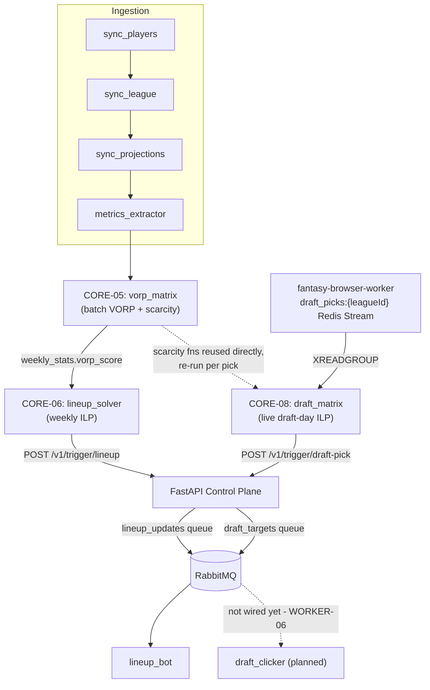
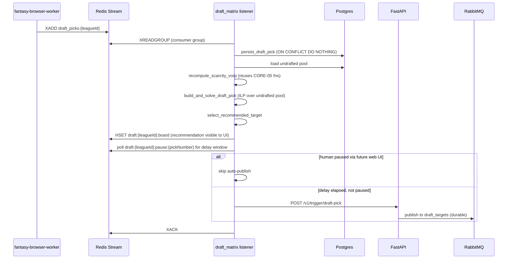

# fantasy-core-pipeline

The core intelligence layer of your automated fantasy football infrastructure. It performs data transformations, tracks utilization metrics, solves linear roster models, and exposes an internal control API.

## Repository Layout
*   `src/api/`: FastAPI Control Plane router, middleware definitions, and Model Context Protocol (MCP) data tools.
*   `src/ingestion/`: Scrapers managing deterministic JSON transformations from Sleeper and `nflverse`.
*   `src/optimization/`: `PuLP` matrix logic calculating dynamic VORP values and optimizing active lineups and live draft-day picks.

## Architecture: how the algorithms chain together

Ingestion feeds CORE-05's VORP matrix, which both the weekly lineup solver (CORE-06) and
the live draft-day board (CORE-08) consume as their objective weight. Both optimizers hand
off to FastAPI, which is the only thing in this repo that talks to RabbitMQ - neither
optimization module publishes directly, so `fantasy-browser-worker`'s bots only ever react
to messages that passed through the control-plane API.



`draft_clicker` already exists in `fantasy-browser-worker` and expects this exact
`{player_id, name}` payload shape, but isn't dispatched to consume `draft_targets` yet -
that wiring, plus declaring the queue in `fantasy-infra`, is WORKER-06/INFRA-07, not part
of this repo.

### CORE-08's live draft-day loop



## Schema Notes

Design rationale for `src/models.py` DDL that's too deep for an inline comment.

### id-space contract

`players.player_id` is Sleeper's internal id -- a different, numerically-overlapping
namespace from ESPN's ids (crosswalk: `players.espn_id`, ~845/1027 covered). Every
table that stores a `player_id` (`raw_signals`, `rumor_signals`, `execution_log`,
`bot_decisions`) uses this internal id, never an ESPN id directly.

Never forward one of these values into an ESPN-id-only field (e.g.
fantasy-browser-worker's `waiver_sniper.js`/`lineup_bot.js` player/drop ids) without
translating through `players.espn_id` first. `api/routes.py`'s
`_reject_internal_player_id` exists specifically to catch this: the two id spaces
collide numerically (ESPN id 12483 is Matthew Stafford; internal id 12483 is Jack
Bech), so a translation bug here is silent and undetectable downstream.

### `rumor_signals`

- No `CHECK` constraints on `sentiment`/`suggested_action`: validation of the writer's
  output shape lives in fantasy-browser-worker's digest bot, matching `raw_signals`'
  precedent of staying schema-free of interpretation logic.
- `ON DELETE CASCADE` on `player_id` (not `raw_signals`' `SET NULL`): a signal with no
  player to attach to is meaningless, unlike raw ingestion history.
- No separate watermark/cursor table. `max_raw_signal_id` is stamped on every row a
  digest run writes -- including `no_op` verdicts -- with that run's batch-max
  `raw_signals.id`. `MAX(max_raw_signal_id)` across the table is the watermark; this
  only holds because the digest always writes one verdict per distinct player in its
  batch, even a `no_op` one, so every `raw_signal` considered gets accounted for.
- `source_raw_signal_ids` keeps cheap provenance (which raw_signals rows produced a
  verdict) for debugging.
- No `UNIQUE(player_id)`: a later run legitimately re-evaluates a player as new items
  arrive, so multiple rows per player over time are expected -- the latest row per
  player_id is the current signal.

## Local Configuration
Ensure you match your system parameters before booting the engine:
```bash
python -m venv venv
source venv/bin/activate
pip install -r requirements.txt
```

`requirements.txt`'s pins target the `python:3.11-slim` image used in `Dockerfile` and
CI. On newer local Python versions (3.13+), some pins (`pydantic-core`,
`psycopg2-binary`) may fail to build from source - install unpinned/latest versions in
your local venv instead (`pip install fastapi uvicorn pydantic ... `, omitting `==`
version pins) rather than editing `requirements.txt` itself.

## Pre-commit Hook
`.githooks/pre-commit` runs the same three checks as CI's `lint-test` job (see below)
before each commit, blocking on pytest failures the same way CI blocks merges. Git
doesn't auto-enable hooks committed to a repo (that would let a clone run arbitrary code
on checkout), so opt in once per clone:
```bash
git config core.hooksPath .githooks
```
This is a local, per-clone setting - not something a global `git config --global` value
or this repo's history can turn on for you. Bypass it for one commit with
`git commit --no-verify` if you need to (e.g. a WIP commit on a scratch branch).

## Running CI Checks Locally
`.github/workflows/ci.yml`'s `lint-test` job runs three steps in order; reproduce them
the same way before pushing:
```bash
black --check .      # non-blocking in CI (continue-on-error), but keep drift visible
mypy src/             # also non-blocking - several third-party deps lack type stubs
DB_PASSWORD=test pytest tests/ -v   # this one DOES block merges
```
`pytest` is the only step that actually fails the CI job; `black`/`mypy` only report
formatting/typing drift without blocking. `DB_PASSWORD` just silences a startup warning
in `src/database.py` - no real credential is used, since `tests/conftest.py` mocks the
Postgres connection pool before test collection, so the whole suite runs without a live
database or broker.

If `pip install -r requirements.txt` itself fails in CI (a dependency conflict, not a
lint/test failure), reproduce the *exact* resolution CI sees with:
```bash
docker run --rm -v "$PWD/requirements.txt:/req.txt:ro" python:3.11-slim \
  pip install --dry-run -r /req.txt
```
This matters because environment markers in a package's dependencies (e.g. "requires X
version Y on Python >=3.14") are evaluated against whichever Python is *running* pip -
so a local dry run under a newer interpreter than 3.11 can report a false conflict (or
miss a real one) that CI's actual 3.11 runner wouldn't hit.

## Argo CD Image Updater Contract
Main-branch pushes publish `ghcr.io/cvillarr23/fantasy-core-pipeline` with mutable `:main`
and `:latest` tags plus an immutable SHA tag. Argo CD Image Updater in `fantasy-infra`
should track this image in digest mode and commit `@sha256:...` write-backs to `main`.

Expected `fantasy-infra` Application annotations:
- `argocd-image-updater.argoproj.io/image-list: core-pipeline=ghcr.io/cvillarr23/fantasy-core-pipeline`
- `argocd-image-updater.argoproj.io/core-pipeline.update-strategy: digest`
- `argocd-image-updater.argoproj.io/write-back-method: git`

The updater write-back target should be a deterministic Kustomize-managed image field so
automated commits only change digest-pinned image references.

## Project Tracking
Engineering tickets for this repo live as [GitHub Issues](https://github.com/cvillarr23/fantasy-core-pipeline/issues) and are tracked on the [Fantasy Manager project board](https://github.com/users/cvillarr23/projects/2), alongside `fantasy-browser-worker` and `fantasy-infra`.

### Rumor-action application outcomes (#140)

The daily CronJob invokes `python -m src.services.rumor_action_service` directly; the
HTTP route shares its service. Each invocation records exactly one `execution_log`
row (`transaction_type=rumor_action_trigger`, `bot_name=rumor_action_service`).
`outcome_details` is an additive nullable JSONB column migrated at API startup, before
CronJobs using the new image should run. Existing execution-log writers are unchanged.

The details include a run ID, source (`cli`, `http`, or `service`), Job name when supplied,
team/season/week, watermark range, signal reasons and separate action counts. No new
signals, non-qualifying/superseded signals, no beneficial move, and already-queued
responses are healthy `success` outcomes. Unresolved identities for proposed actions,
unaccounted work or exceptions produce `failure`, or `partial_failure` if other actions
were accepted/already queued. Incomplete work now raises to the CLI/HTTP caller, so
the CLI exits nonzero and HTTP returns 500. The public response shape is unchanged.

Action acceptance means queued by the core API, not completed in ESPN. Response lists
contain only newly accepted actions; structured counts distinguish accepted versus
duplicate actions. A structured `rumor_action_outcome` log is emitted
for every invocation before the best-effort database write, so it remains searchable
even when that write fails.

The Grafana rule/dashboard/runbook are owned by fantasy-infra. The rule counts failures
in a 26-hour window, so a later empty success cannot conceal lost work. It does not alert
on zero action volume.

### Rumor-action retries (#192)

Deploy the API migration creating `rumor_action_checkpoints` before running the new
CronJob image. This per-team PostgreSQL checkpoint owns the watermark after its first
initialization from Redis's legacy `rumor_action:last_processed_id`. Redis remains a
compatibility mirror; clearing Redis does not replay completed work. Initial migration
preserves the old cursor and cannot recover signals older versions already skipped.
The legacy cursor assumes the existing single configured team at cutover.

Only a contiguous prefix of handled signals advances the cursor. Prepared payloads,
original lineup idempotency keys, and successful deliveries beyond a gap survive pod
restarts. New waiver signals for a player with a pending prepared waiver action are
covered by that action and cannot queue a second copy. New bench-watch signals wait
behind any pending lineup action and remain behind the watermark until a later invocation
can evaluate them. Checkpoints commit before publishing and after each outcome, using
optimistic version checks so overlapping invocations fail instead of overwriting progress.
No DB connection is held across publishing. A lost acknowledgement or failed
post-publish checkpoint replays the saved payload under its original gateway key.

Three exhausted publisher calls deliberately drop an action with `retry_limit_exceeded`;
internal HTTP attempts count as one call. Drop details (signal IDs, attempts, reason,
last error) are retained in the `execution_log` outcome. The checkpoint retains only
pending work and bounded retry state. Non-qualifying, superseded, and no-beneficial-move
signals are healthy no-ops. Missing ESPN identities are deliberate drops that fail the
invocation. Shared DB/projection/solver failures
leave signals pending without consuming their publish allowance; three failed evaluation
runs or a 24-hour age limit eventually record an evaluation drop.

Ambiguous lineup actions expire 20 minutes after preparation, before the gateway's
30-minute dedupe TTL; they are recorded as `lineup_retry_window_expired` without replay.
Waiver actions expire after 24 hours as `waiver_retry_window_expired`.
Prepared actions from a different season/week are dropped as `decision_week_expired`.
The invocation that drops work still fails. Its `JOB_NAME` is recorded as failed so extra
pods of that Job cannot report empty success; later Jobs may proceed. Until the infra
rollout supplies `JOB_NAME`, only rumor-trigger CLI pods use their generated pod hostname
to identify OnFailure restarts; local CLI runs do not persist a host-wide failure marker.
Pending actions are still retried even if another action has already made the Job
permanently fail.
Failed-Job markers expire after seven days.

The infra follow-up sets `restartPolicy: Never`, `backoffLimit: 2`, and `JOB_NAME` from
`metadata.labels['batch.kubernetes.io/job-name']`, only after this core image and schema
are deployed. Waiver keys remain scoped to claim/week without `JOB_NAME`.

### Human approval of staged trade offers

`GET /v1/trade/offers?status=awaiting_approval` lists worker-staged offers, newest
first. Optional `league_id`, `season`, `limit` (1–200, default 50), and `offset`
filter/page the results. Player names resolve through `players.espn_id`; unknown
players retain their ESPN IDs and a null name. The exact manager message is shown.
Pod-local screenshots are not served.

`POST /v1/trade/offers/{offer_key}/approve` accepts only
`{"approved_by":"your-name"}`. As with the existing trade evaluation route, there
is no application-layer authentication: the approver is self-reported, and access
relies on the deployment's trust boundary. No offer fields may be supplied in the
request. The stored offer must match the worker's SHA-256 contract and configured
`ESPN_LEAGUE_ID`/`ESPN_TEAM_ID`. IDs inside this trade JSON are explicitly **ESPN**
IDs, including negative D/ST IDs; do not translate them as internal player IDs.

Successful publication returns 202 (`status: approved` means enqueued, not sent in
ESPN). A repeated confirmed approval returns 200 and the original tracking ID,
without another publish. Unknown keys return 404; invalid/edited offers and
non-approvable states return 409. Blank approvers and extra body fields return 422.
The worker still enforces its dry-run, trade-enable, approval, and selector gates.

Approval uses PostgreSQL locking across all rows for an offer key, with the
approver, timestamp, tracking ID, and exact payload persisted under
`execution_log.outcome_details.approval`. A `bot_decisions` entry with action
`trade_offer` commits in the same transaction. The `approval_pending` claim commits
**before** AMQP publication; only a confirmed publish changes it to `approved`.
Failures proven to precede publication release the claim. An ambiguous failure or
process crash leaves it pending indefinitely, so retries cannot enqueue twice.
There is no automatic retry or expiry for uncertain publications.

For a stuck pending approval, reconcile its tracking ID with broker/worker logs
and the worker's `submitting`/`submitted` rows (and ESPN outcome when necessary).
Do not reset or republish merely because an HTTP request failed or timed out. Only
an operator who has established that nothing was queued/sent may release the
claim; an unknown outcome must stay blocked. No recovery endpoint is provided.

Offline regression tests: `python -m pytest tests/test_trade_offers.py`. Hash
fixtures were generated from fantasy-browser-worker's `computeOfferKey` on main;
they cover exact whitespace, Unicode, null messages, sorted IDs, and D/ST IDs.


## League trade context

### ESPN score and schedule ingestion

`python -m src.ingestion.sync_actual_scores --season 2026` refreshes all completed
scoring weeks plus the fantasy schedule. It uses `ESPN_LEAGUE_ID`, `ESPN_S2` and
`ESPN_SWID`, the same OpenBao-injected environment as `sync_league`; never put cookies
in command arguments or files. The configured league is required, with no default.

For initial backfill, validate with:

```bash
python -m src.ingestion.sync_actual_scores --season 2026 --start-week 1 --end-week 4 --dry-run
```

After operator approval for the destination database, omit `--dry-run` to persist.
`--week N` selects one week; a range selects several. Dry-run does not import the database
module or connect to Postgres/Redis. Upcoming weeks fail rather than silently resolving to
ESPN's current week. Preseason runs refresh schedule evidence without inventing scores.

A completed scoring week requires every game from ESPN's professional schedule to appear
as completed in the NFL scoreboard, ESPN's professional `statsOfficial` flags, complete
league-team coverage, historical lineups, and
finite actual scores. A completed fantasy matchup period also needs ESPN's decided result.
Multiweek periods keep per-scoring-week scores separate from cumulative matchup totals.
The final season week can complete without a scoring-period rollover. "Completed" means
available final results, not immunity from subsequent ESPN stat corrections.

`fantasy_matchups` stores league/season/period/team pairings and scoring-week mappings,
including explicit byes and unavailable schedule evidence. `fantasy_team_week_scores`
stores completed team scores and historical display lineups. `fantasy_player_week_scores`
retains every historical roster player, including bench/IR, unmapped ESPN identities and
negative D/ST IDs; it does not claim coverage of all unrostered NFL players. Missing
player actuals/projections remain null; zero and negative actuals remain real values.

Each completed week is validated before one transaction writes its schedule, team and player
history. A league/season advisory lock serializes writes; reruns replace the week's rows and
upsert results, including corrections and withdrawn lineup entries. Failures roll back the
whole week. Previously committed weeks remain valid if a later week in a range fails.
After commit, ingestion invalidates the existing league read-cache version.

Mapped player actuals update existing `(player_id, season, week)` `weekly_stats` rows only,
with `actual_points_source='espn:<league>'` and `actual_points_updated_at`. Projection,
VORP and metric fields are preserved; ingestion never creates default-filled metric rows.
Unmapped or ambiguous identities remain in score history and can be mirrored on a later
rerun after crosswalk/metrics ingestion. Actuals withdrawn from this job's previous snapshot
are cleared instead of leaving stale values. Existing default-zero rows without source
metadata must not be treated as observed ESPN results.

Completed matchup/scoreboard reads use stored historical lineups and omit current lineup
advice. Un-ingested/current weeks retain live ESPN reads and the existing 60-second cache.
Current roster ownership, injury and IR eligibility remain live. Historical projections and
missing player points may be null in matchup responses.

**Separate fantasy-infra follow-up:** add a score-ingestion CronJob after the later Tuesday
weekly ingestor from fantasy-infra#137, plus Friday reconciliation. Reprocess all completed
weeks to recover missed/late-final weeks and corrections; keep the professional-game gate,
bounded ESPN requests, failed-job alerts, and `concurrencyPolicy: Forbid`. The job should run
after player crosswalks and weekly metrics, before downstream consumers needing stored
results. No cluster manifests are changed here. Initial production migration/backfill is an
operator action, separate from code verification.

Optional local integration checks use a disposable localhost database:
`SCORE_HISTORY_TEST_DSN='host=127.0.0.1 port=<port> dbname=<db> user=<user> password=<test password>'
DB_PASSWORD=test python -m pytest tests/test_score_history_postgres.py`.

### Trade context reads

`GET /v1/trade/context?league_id=<configured ESPN league>&season=2026&week=3&horizon=4`
returns league-wide current roster ownership and upcoming fantasy head-to-head schedule
context. The MCP tool `get_league_trade_context_model` uses the same service. The service
supports the configured ESPN league; `horizon` defaults to four scoring weeks, accepts
1–18, and stops at the league's regular-season end from ESPN matchup-period settings.
Multiweek matchup periods are expanded into their actual scoring weeks. After the regular
season the returned schedule is empty.

Each roster player has separate `espn_id` and internal `player_id` fields, lineup and
eligible slots, and exact-week database VORP/projections for the horizon. An unavailable or
ambiguous identity mapping remains null; it never falls back to a numerically matching ID.
Missing metrics remain null and are counted in `coverage.missing_metric_count` (one count
per player/week with either metric missing). Unmatched ESPN roster players remain visible.
Ownership comes from ESPN's current roster snapshot, not the database's last roster sync.
`roster_snapshot` identifies its fetch time and observed week; selecting a historical week
does not reconstruct historical ownership. Successful responses are cached for 60 seconds
and invalidated by the existing verified-move league cache version.

The `completed_fantasy_points_per_week_z` strength metric uses each team's completed
stored ESPN regular-season scores before both the selected and observed ESPN week,
divided by the number of scoring weeks represented. Every scoring week of a fantasy
matchup period must be ingested before that period contributes. Scores from in-progress or later
matchups do not enter the metric. The league mean and population standard deviation
standardize teams with observations; positive z means stronger. Fewer than two observed
teams produces unknown z scores; equal observed strengths produce zero. Sample counts and
`unavailable_history_periods` expose incomplete history. This describes past fantasy
scoring and does not predict win probabilities or measure NFL defense difficulty.

Each schedule week distinguishes `scheduled`, explicit `bye`, and `unavailable` pairings.
Pairings and strength come from the ingestion tables; missing stored history does not fall
back to live ESPN totals. Current ownership and the observed ESPN week remain live.
A team's `schedule_strength_z` is the mean opponent z across non-bye scoring weeks, and
is null unless every such week has a known pairing and strength. Missing/ambiguous
pairings and unknown scores are reported in `schedule_coverage` rather than treated as
byes or zero-strength opponents. A bye-only or empty horizon has no schedule score.

## Trade scoring

`POST /v1/trade/score` (MCP tool `score_trade_proposal`, same service) scores one proposal
deterministically on top of the league trade context:

```json
{"league_id": "123", "season": 2026, "week": 5, "horizon": 4,
 "our_team_id": "1", "counterparty_team_id": "2",
 "send_espn_ids": ["4241457"], "receive_espn_ids": ["-16002"]}
```

Player IDs are **ESPN** IDs only (D/ST IDs are negative). They never match internal
`player_id`s, which can be numerically equal to a different player's ESPN ID. Each sent
player must be on `our_team_id`'s current ESPN roster and each received player on
`counterparty_team_id`'s, or the route returns 409. Malformed proposals or unknown teams
return 422. Context failures map like `/v1/trade/context` (503/504/502).
`POST /v1/trade/evaluate` is unchanged.

Positive numbers are good for `our_team_id`. For each horizon week, both teams' optimal
starting lineups are solved before and after the trade with the lineup optimizer's ILP,
over current rosters and that week's `vorp_score`. Bench and IR are worth nothing. ΔL is
after minus before.

- `our_lineup_gain` G is the sum of our ΔL. `counterparty_lineup_change` I is the sum of
  theirs; negative means they got weaker.
- `m(z) = 1 + 0.25 × clamp(z, −2, 2)`, where z is that week's fantasy opponent strength
  from the trade context. A fantasy bye weighs 0.
- `our_weighted_gain` G* = Σ our ΔL × m(our opponent's z).
  `our_schedule_adjustment` = G* − G.
- `counterparty_weighted_benefit` C* = Σ −(their ΔL) × c. In a week they play us,
  c = our own m. Otherwise c = 0.25 × m(their opponent's z), so weakening them ahead of
  tougher matchups counts more, but less than head-to-head.
- `final_score` = G* + C*.

The constants are echoed in `weights`, and `scoring_version` names the formula.
`raw_vorp` is `/v1/trade/evaluate`'s result for the as-of week, using the mapped internal
IDs. Per-week `starters_before`/`starters_after`, `held_slots` and `excluded_players`,
plus the per-week schedule rows, are the evidence an explanation should quote. Uneven
trades set `exceeds_roster_limit`; drops are not simulated.

Nothing is filled in:

- A week is **unscored**, with reasons, if a traded player lacks a mapping or that week's
  metrics, or a lineup can't be filled. A traded player whose NFL team is on a bye simply
  sits that week.
- An unfillable K or D/ST slot is held on both sides.
- Untraded players without metrics are left out and reported in
  `coverage.partial_roster_weeks`.
- If the NFL schedule can't be read, a missing projection can't be confirmed as a bye.
- Unknown opponent strength or pairing leaves G*, C* or `final_score` null, with a reason.
- An empty or bye-only horizon has no final score.

Projections and VORP are currently refreshed for the upcoming week only, so later horizon
weeks usually come back unscored and `complete_horizon` is false.
