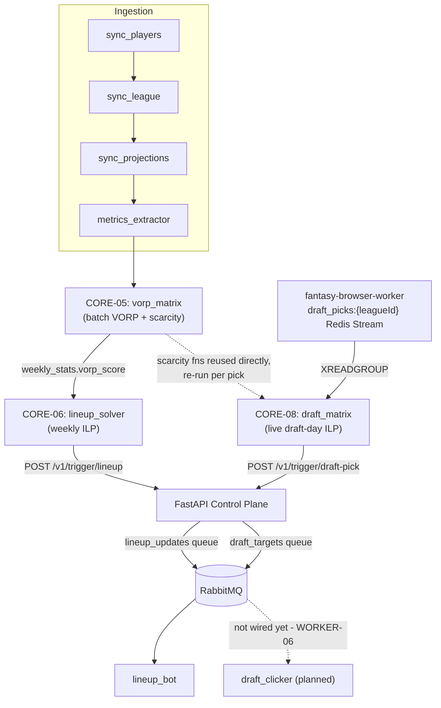
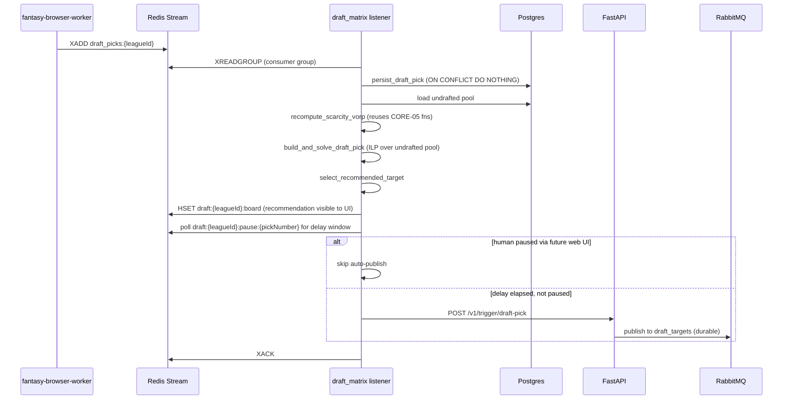

# fantasy-core-pipeline

The core intelligence layer of your automated fantasy football infrastructure. It performs data transformations, tracks utilization metrics, solves linear roster models, and exposes an internal control API.

## Repository Layout
*   `src/api/`: FastAPI Control Plane router, middleware definitions, and Model Context Protocol (MCP) data tools.
*   `src/ingestion/`: Scrapers managing deterministic JSON transformations from Sleeper and `nflverse`.
*   `src/optimization/`: `PuLP` matrix logic calculating dynamic VORP values and optimizing active lineups and live draft-day picks.

## Architecture: how the algorithms chain together

Ingestion feeds CORE-05's VORP matrix, which both the weekly lineup solver (CORE-06) and
the live draft-day board (CORE-08) consume as their objective weight. Both optimizers hand
off to FastAPI, which is the only thing in this repo that talks to RabbitMQ - neither
optimization module publishes directly, so `fantasy-browser-worker`'s bots only ever react
to messages that passed through the control-plane API.



`draft_clicker` already exists in `fantasy-browser-worker` and expects this exact
`{player_id, name}` payload shape, but isn't dispatched to consume `draft_targets` yet -
that wiring, plus declaring the queue in `fantasy-infra`, is WORKER-06/INFRA-07, not part
of this repo.

### CORE-08's live draft-day loop



## Local Configuration
Ensure you match your system parameters before booting the engine:
```bash
python -m venv venv
source venv/bin/activate
pip install -r requirements.txt
```

`requirements.txt`'s pins target the `python:3.11-slim` image used in `Dockerfile` and
CI. On newer local Python versions (3.13+), some pins (`pydantic-core`,
`psycopg2-binary`) may fail to build from source - install unpinned/latest versions in
your local venv instead (`pip install fastapi uvicorn pydantic ... `, omitting `==`
version pins) rather than editing `requirements.txt` itself.

## Pre-commit Hook
`.githooks/pre-commit` runs the same three checks as CI's `lint-test` job (see below)
before each commit, blocking on pytest failures the same way CI blocks merges. Git
doesn't auto-enable hooks committed to a repo (that would let a clone run arbitrary code
on checkout), so opt in once per clone:
```bash
git config core.hooksPath .githooks
```
This is a local, per-clone setting - not something a global `git config --global` value
or this repo's history can turn on for you. Bypass it for one commit with
`git commit --no-verify` if you need to (e.g. a WIP commit on a scratch branch).

## Running CI Checks Locally
`.github/workflows/ci.yml`'s `lint-test` job runs three steps in order; reproduce them
the same way before pushing:
```bash
black --check .      # non-blocking in CI (continue-on-error), but keep drift visible
mypy src/             # also non-blocking - several third-party deps lack type stubs
DB_PASSWORD=test pytest tests/ -v   # this one DOES block merges
```
`pytest` is the only step that actually fails the CI job; `black`/`mypy` only report
formatting/typing drift without blocking. `DB_PASSWORD` just silences a startup warning
in `src/database.py` - no real credential is used, since `tests/conftest.py` mocks the
Postgres connection pool before test collection, so the whole suite runs without a live
database or broker.

If `pip install -r requirements.txt` itself fails in CI (a dependency conflict, not a
lint/test failure), reproduce the *exact* resolution CI sees with:
```bash
docker run --rm -v "$PWD/requirements.txt:/req.txt:ro" python:3.11-slim \
  pip install --dry-run -r /req.txt
```
This matters because environment markers in a package's dependencies (e.g. "requires X
version Y on Python >=3.14") are evaluated against whichever Python is *running* pip -
so a local dry run under a newer interpreter than 3.11 can report a false conflict (or
miss a real one) that CI's actual 3.11 runner wouldn't hit.

## Argo CD Image Updater Contract
Main-branch pushes publish `ghcr.io/cvillarr23/fantasy-core-pipeline` with mutable `:main`
and `:latest` tags plus an immutable SHA tag. Argo CD Image Updater in `fantasy-infra`
should track this image in digest mode and commit `@sha256:...` write-backs to `main`.

Expected `fantasy-infra` Application annotations:
- `argocd-image-updater.argoproj.io/image-list: core-pipeline=ghcr.io/cvillarr23/fantasy-core-pipeline`
- `argocd-image-updater.argoproj.io/core-pipeline.update-strategy: digest`
- `argocd-image-updater.argoproj.io/write-back-method: git`

The updater write-back target should be a deterministic Kustomize-managed image field so
automated commits only change digest-pinned image references.

## Project Tracking
Engineering tickets for this repo live as [GitHub Issues](https://github.com/cvillarr23/fantasy-core-pipeline/issues) and are tracked on the [Fantasy Manager project board](https://github.com/users/cvillarr23/projects/2), alongside `fantasy-browser-worker` and `fantasy-infra`.
