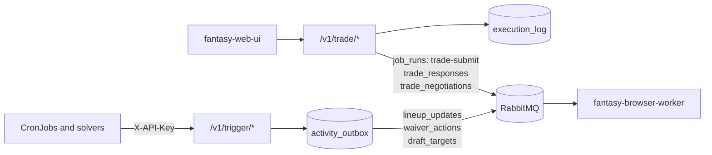

The core API is a FastAPI app. All routes live under `/v1`. The full machine-readable schema, with request and response models, is [`openapi.json`](./openapi.json).

:::note[Regenerating]
The tables below and `openapi.json` are generated from the app. After adding or changing a route, run `DB_PASSWORD=test python scripts/export_openapi.py`. A test fails if either file is stale or a route has no description.
:::

## How requests are authorized

| Caller | Gate |
|---|---|
| Browser users | `oauth2-proxy` in front of `fantasy-web-ui`. The API itself does not check user identity. |
| In-cluster CronJobs and `fantasy-browser-worker` | `X-API-Key` header, checked against `TRIGGER_API_KEY`. |

The `X-API-Key` column marks the routes that enforce the header. Without a configured `TRIGGER_API_KEY`, those routes return 500; with a wrong key, 401.

## Which endpoints act on ESPN

Accepted means queued by the API, not done on ESPN. See [Queue publishing](./queue-publishing.md) for payloads and idempotency.

## Endpoints

<!-- BEGIN GENERATED: endpoints -->

### Trigger

| Method | Path | Purpose | `X-API-Key` | Publishes to |
|---|---|---|---|---|
| `POST` | `/v1/trigger/draft-pick` | Queue the recommended draft pick. | Yes | `draft_targets` |
| `POST` | `/v1/trigger/lineup` | Queue lineup swaps and IR moves. | Yes | `lineup_updates` |
| `POST` | `/v1/trigger/rumor-action` | Evaluate rumor signals now and queue the resulting moves. | No | `lineup_updates`, `waiver_actions` |
| `POST` | `/v1/trigger/waiver` | Queue a waiver claim, optionally held behind an IR move. | Yes | `waiver_actions` |

### Trade

| Method | Path | Purpose | `X-API-Key` | Publishes to |
|---|---|---|---|---|
| `GET` | `/v1/trade/candidates` | List the latest precomputed league-wide trade candidates. | No |  |
| `GET` | `/v1/trade/context` | Show current rosters and head-to-head schedule evidence for trades. | No |  |
| `POST` | `/v1/trade/evaluate` | Compute raw VORP delta for a trade. | No |  |
| `GET` | `/v1/trade/incoming` | List incoming trade offers with scores and negotiation state. | No |  |
| `POST` | `/v1/trade/incoming/{espn_transaction_id}/counter` | Queue a counter offer for an incoming offer. | Yes | `trade_negotiations` |
| `POST` | `/v1/trade/incoming/{espn_transaction_id}/decision` | Queue an accept or decline for an incoming offer. | Yes | `trade_responses` |
| `POST` | `/v1/trade/incoming/{espn_transaction_id}/decision/retry` | Queue the same response again after a rejected or unknown attempt. | Yes | `trade_responses` |
| `GET` | `/v1/trade/incoming/{espn_transaction_id}/thread` | Show one offer's negotiation thread. | No |  |
| `POST` | `/v1/trade/incoming/{espn_transaction_id}/triage` | Dismiss or snooze an incoming offer. | Yes |  |
| `GET` | `/v1/trade/offers` | List generated trade proposals with their stored score evidence, or look one up by offer_key. | No |  |
| `POST` | `/v1/trade/offers/{offer_key}/approve` | Approve a staged proposal and start its trade-submit run. | No | `job_runs` |
| `POST` | `/v1/trade/offers/{offer_key}/dismiss` | Retire an unapproved proposal so it leaves the approval list. | No |  |
| `POST` | `/v1/trade/offers/{offer_key}/resolution` | Record how ESPN resolved a sent offer, freeing its players for new trades. | Yes |  |
| `POST` | `/v1/trade/score` | Compute the schedule-aware trade score. | No |  |

### Draft day

| Method | Path | Purpose | `X-API-Key` | Publishes to |
|---|---|---|---|---|
| `POST` | `/v1/draft/auto-publish` | Turn draft auto-publish on or off. | No |  |
| `GET` | `/v1/draft/config` | Read the stored live draft config. | No |  |
| `POST` | `/v1/draft/config` | Store the league, team, season and mode for the draft listener. | No |  |
| `GET` | `/v1/draft/logs` | Tail the listener or room connector pod log. | No |  |
| `POST` | `/v1/draft/pause` | Pause the auto-publish for a pick. | No |  |
| `DELETE` | `/v1/draft/practice/sync-job` | Cancel the practice runs and clear their Redis state. | No |  |
| `POST` | `/v1/draft/practice/sync-job` | Request the room connector run for a practice room. | No |  |
| `GET` | `/v1/draft/practice/sync-job/status` | Show the practice connector run's state. | No |  |
| `POST` | `/v1/draft/resume` | Recompute and republish the recommendation. | No |  |
| `POST` | `/v1/draft/start` | Request the draft listener run from the job launcher. | No |  |
| `GET` | `/v1/draft/status` | Show draft board, run and listener state. | No |  |
| `POST` | `/v1/draft/stop` | Cancel a league's draft runs and clear its Redis state. | No |  |
| `GET` | `/v1/draft/stream` | Stream draft status as server-sent events. | No |  |

### Activity

| Method | Path | Purpose | `X-API-Key` | Publishes to |
|---|---|---|---|---|
| `GET` | `/v1/activity/actions` | List queued actions with their delivery and verification state. | No |  |
| `GET` | `/v1/activity/actions/{identity}` | Show one action with its event timeline. | No |  |
| `POST` | `/v1/activity/actions/{identity}/check` | Re-verify an action against ESPN now. | No |  |
| `GET` | `/v1/activity/bots` | Summarize each bot's recent activity. | No |  |
| `GET` | `/v1/activity/jobs` | Latest run and recent failure count per job, plus dead-letter queue depths. | No |  |
| `POST` | `/v1/activity/read/{identity}` | Mark an activity item read. | No |  |
| `GET` | `/v1/activity/runs` | List job and bot runs (audit log), newest first. | No |  |
| `GET` | `/v1/activity/runs/{identity}` | Show one run with its trigger, inputs, outputs and child runs. | No |  |
| `GET` | `/v1/activity/sessions` | List bot sessions. | No |  |
| `GET` | `/v1/activity/sessions/{identity}` | Show one bot session. | No |  |
| `GET` | `/v1/activity/trace` | Trace an article, rumor evaluation or move through the rumor pipeline. | No |  |

### Jobs

| Method | Path | Purpose | `X-API-Key` | Publishes to |
|---|---|---|---|---|
| `GET` | `/v1/jobs` | List catalog jobs and chains, including overrides and latest runs. | No |  |
| `GET` | `/v1/jobs/resource-suggestions` | Suggest each job's catalog resources from its runs' measured CPU and memory. | No |  |
| `DELETE` | `/v1/jobs/{name}/pause` | Remove a job or chain pause. | Yes |  |
| `PUT` | `/v1/jobs/{name}/pause` | Pause a catalog job or chain until a time, or indefinitely. | Yes |  |
| `POST` | `/v1/jobs/{name}/runs` | Queue a catalog job run for the launcher. | Yes | `job_runs` |
| `GET` | `/v1/launcher/health` | Show launcher heartbeat age, queue depths and run counts. | No |  |
| `GET` | `/v1/runs/{identity}` | Show one launcher run and its linked activity. | No |  |
| `POST` | `/v1/runs/{identity}/approve` | Approve a waiting approval run and start its run. | Yes |  |
| `POST` | `/v1/runs/{identity}/cancel` | Cancel a queued, running or waiting launcher run. | Yes |  |
| `POST` | `/v1/runs/{identity}/dismiss` | Dismiss a waiting approval run. | Yes |  |
| `POST` | `/v1/runs/{run_id}/approvals` | Ask a person to approve a run (or confirm) for a running run. | Yes |  |

### Roster and waivers

| Method | Path | Purpose | `X-API-Key` | Publishes to |
|---|---|---|---|---|
| `GET` | `/v1/roster/bye-outlook` | Show which upcoming weeks NFL byes leave the lineup short. | No |  |
| `GET` | `/v1/roster/deficits` | Show per-position roster deficits. | No |  |
| `POST` | `/v1/roster/move-preview` | Preview the effect of a roster move. | No |  |
| `GET` | `/v1/waiver/free-agents` | Browse all claimable free agents with metrics and same-position swap values. | No |  |
| `GET` | `/v1/waiver/recommendations` | Recommend waiver adds and drops. | No |  |

### League and matchup

| Method | Path | Purpose | `X-API-Key` | Publishes to |
|---|---|---|---|---|
| `GET` | `/v1/league/current-week` | Show the current NFL week. | No |  |
| `GET` | `/v1/league/player-leaders` | Show top scorers. | No |  |
| `GET` | `/v1/league/standings` | Show league standings. | No |  |
| `GET` | `/v1/league/teams` | List league teams. | No |  |
| `GET` | `/v1/matchup` | Show our matchup for a season and week. | No |  |
| `GET` | `/v1/matchup/roster` | Show a matchup roster with swap and IR suggestions. | No |  |
| `GET` | `/v1/matchup/scoreboard` | Show every matchup's score for a season and week. | No |  |
| `GET` | `/v1/scoreboard` | Same as `/v1/matchup/scoreboard`. | No |  |

### Players and stats

| Method | Path | Purpose | `X-API-Key` | Publishes to |
|---|---|---|---|---|
| `GET` | `/v1/news` | Merged, de-duplicated player news, newest first. | No |  |
| `GET` | `/v1/news/recent` | Whether each player has news from the last 24 hours. | No |  |
| `GET` | `/v1/players/search` | Search players by name. | No |  |
| `GET` | `/v1/players/{player_id}/summary` | Show one player's season summary. | No |  |
| `GET` | `/v1/stats/vorp` | List VORP scores. | No |  |

### Backtests

| Method | Path | Purpose | `X-API-Key` | Publishes to |
|---|---|---|---|---|
| `GET` | `/v1/backtest/results` | List backtest runs. | No |  |
| `GET` | `/v1/backtest/results/{season}` | Show the backtest for a season. | No |  |

### Chat and health

| Method | Path | Purpose | `X-API-Key` | Publishes to |
|---|---|---|---|---|
| `POST` | `/v1/chat/query` | Ask the LLM a roster or waiver question. | No |  |
| `GET` | `/v1/health` | Check Postgres and RabbitMQ reachability. | No |  |
| `GET` | `/v1/livez` | Liveness probe; checks no dependencies. | No |  |

<!-- END GENERATED: endpoints -->

## Matchup response fields

Notes on `GET /v1/matchup` (and the team fields shared with `GET /v1/matchup/scoreboard`) that the schema alone doesn't say.

### `game_status`

Each player line carries `game_status`: where that player's NFL game stands.

| Value | Meaning |
|---|---|
| `not_started` | The game hasn't kicked off. |
| `in_progress` | The game is under way. |
| `final` | The game is over. |
| `null` | Unknown: the NFL scoreboard couldn't be read, the player's team has no game this week (a bye; `bye_week` says so), or the week is stored completed history, which carries no game status. |

The status comes from ESPN's public NFL scoreboard (`pre`, `in` and `post`), once per response. A failed read gives `null` on every line rather than failing the request. The matchup is cached for 60 seconds, so a status can lag a kickoff or a final whistle by up to that long.

### When `points` and `projected_points` are null

Use `game_status` to tell an unplayed player from a real 0.0:

- **Live and current weeks** (read from ESPN's box score): both are always numbers. ESPN reports 0.0 for a player whose game hasn't started, so `points: 0.0` with `game_status: not_started` means "not played yet", not "scored nothing". Show a dash.
- **Stored completed weeks**: `null` means ESPN's history had no value, which is unknown, never zero. A starter on a bye is a true 0.0.

`projected_points` on a player is ESPN's static pregame projection. It doesn't move during the game.

### Team `projected` is live

`team.projected` is ESPN's `totalProjectedPointsLive`: for a game in progress it blends points already scored with the projection for what's left. When ESPN sends no live total (nothing under way yet), it falls back to the sum of the starters' static projections. So `team.projected` can move during a game while the players' `projected_points` do not.

### `win_probability`

`team.win_probability` (matchup, and each side of `/v1/matchup/scoreboard`) is ESPN's chance, from 0 to 1 with two decimals, that the team wins the matchup. The two sides sum to 1. ESPN only sends it for the matchup period in progress. It is `null` for a finished or future week, a stored completed week, or when ESPN can't be read.

Probe result (2026 league, read-only, matchup period 11 live): ESPN's raw `mMatchupScore` and `mScoreboard` views include `schedule[].home.winProbability` and `schedule[].away.winProbability`. For a finished period (10) the value is `null`, and a future period (12) doesn't carry the field. The ESPN API client `espn_api` drops it from `BoxScore`, so the API reads the raw payload with one extra request per cache miss.

## Related

- [Activity submissions](./activity-api.md): how to read an action's delivery and verification state.
- [Incoming trade inbox API](./trade-inbox-api.md): the full contract for the `/v1/trade/incoming` routes.
- [Queue publishing](./queue-publishing.md): queue names, payloads and idempotency keys.
