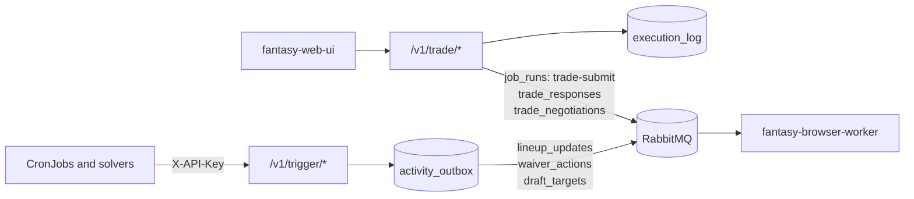

The core API is a FastAPI app. All routes live under `/v1`. The full machine-readable schema, with request and response models, is [`openapi.json`](./openapi.json).

:::note[Regenerating]
The tables below and `openapi.json` are generated from the app. After adding or changing a route, run `DB_PASSWORD=test python scripts/export_openapi.py`. A test fails if either file is stale or a route has no description.
:::

## How requests are authorized

| Caller | Gate |
|---|---|
| Browser users | `oauth2-proxy` in front of `fantasy-web-ui`. The API itself does not check user identity. |
| In-cluster CronJobs and `fantasy-browser-worker` | `X-API-Key` header, checked against `TRIGGER_API_KEY`. |

The `X-API-Key` column marks the routes that enforce the header. Without a configured `TRIGGER_API_KEY`, those routes return 500; with a wrong key, 401.

## Which endpoints act on ESPN

Accepted means queued by the API, not done on ESPN. See [Queue publishing](./queue-publishing.md) for payloads and idempotency.

## Endpoints

<!-- BEGIN GENERATED: endpoints -->

### Trigger

| Method | Path | Purpose | `X-API-Key` | Publishes to |
|---|---|---|---|---|
| `POST` | `/v1/trigger/draft-pick` | Queue the recommended draft pick. | Yes | `draft_targets` |
| `POST` | `/v1/trigger/lineup` | Queue lineup swaps and IR moves. | Yes | `lineup_updates` |
| `POST` | `/v1/trigger/rumor-action` | Evaluate rumor signals now and queue the resulting moves. | No | `lineup_updates`, `waiver_actions` |
| `POST` | `/v1/trigger/waiver` | Queue a waiver claim, optionally held behind an IR move. | Yes | `waiver_actions` |

### Trade

| Method | Path | Purpose | `X-API-Key` | Publishes to |
|---|---|---|---|---|
| `GET` | `/v1/trade/candidates` | List the latest precomputed league-wide trade candidates. | No |  |
| `GET` | `/v1/trade/context` | Show current rosters and head-to-head schedule evidence for trades. | No |  |
| `POST` | `/v1/trade/evaluate` | Compute raw VORP delta for a trade. | No |  |
| `GET` | `/v1/trade/incoming` | List incoming trade offers with scores and negotiation state. | No |  |
| `POST` | `/v1/trade/incoming/{espn_transaction_id}/counter` | Queue a counter offer for an incoming offer. | Yes | `trade_negotiations` |
| `POST` | `/v1/trade/incoming/{espn_transaction_id}/decision` | Queue an accept or decline for an incoming offer. | Yes | `trade_responses` |
| `POST` | `/v1/trade/incoming/{espn_transaction_id}/decision/retry` | Queue the same response again after a rejected or unknown attempt. | Yes | `trade_responses` |
| `GET` | `/v1/trade/incoming/{espn_transaction_id}/thread` | Show one offer's negotiation thread. | No |  |
| `POST` | `/v1/trade/incoming/{espn_transaction_id}/triage` | Dismiss or snooze an incoming offer. | Yes |  |
| `GET` | `/v1/trade/offers` | List generated trade proposals with their stored score evidence, or look one up by offer_key. | No |  |
| `POST` | `/v1/trade/offers/{offer_key}/approve` | Approve a staged proposal and start its trade-submit run. | No | `job_runs` |
| `POST` | `/v1/trade/offers/{offer_key}/dismiss` | Retire an unapproved proposal so it leaves the approval list. | No |  |
| `POST` | `/v1/trade/offers/{offer_key}/resolution` | Record how ESPN resolved a sent offer, freeing its players for new trades. | Yes |  |
| `POST` | `/v1/trade/score` | Compute the schedule-aware trade score. | No |  |

### Draft day

| Method | Path | Purpose | `X-API-Key` | Publishes to |
|---|---|---|---|---|
| `POST` | `/v1/draft/auto-publish` | Turn draft auto-publish on or off. | No |  |
| `GET` | `/v1/draft/config` | Read the stored live draft config. | No |  |
| `POST` | `/v1/draft/config` | Store the league, team, season and mode for the draft listener. | No |  |
| `GET` | `/v1/draft/logs` | Tail the listener or room connector pod log. | No |  |
| `POST` | `/v1/draft/pause` | Pause the auto-publish for a pick. | No |  |
| `DELETE` | `/v1/draft/practice/sync-job` | Cancel the practice runs and clear their Redis state. | No |  |
| `POST` | `/v1/draft/practice/sync-job` | Request the room connector run for a practice room. | No |  |
| `GET` | `/v1/draft/practice/sync-job/status` | Show the practice connector run's state. | No |  |
| `POST` | `/v1/draft/resume` | Recompute and republish the recommendation. | No |  |
| `POST` | `/v1/draft/start` | Request the draft listener run from the job launcher. | No |  |
| `GET` | `/v1/draft/status` | Show draft board, run and listener state. | No |  |
| `POST` | `/v1/draft/stop` | Cancel a league's draft runs and clear its Redis state. | No |  |
| `GET` | `/v1/draft/stream` | Stream draft status as server-sent events. | No |  |

### Activity

| Method | Path | Purpose | `X-API-Key` | Publishes to |
|---|---|---|---|---|
| `GET` | `/v1/activity/actions` | List queued actions with their delivery and verification state. | No |  |
| `GET` | `/v1/activity/actions/{identity}` | Show one action with its event timeline. | No |  |
| `POST` | `/v1/activity/actions/{identity}/check` | Re-verify an action against ESPN now. | No |  |
| `GET` | `/v1/activity/bots` | Summarize each bot's recent activity. | No |  |
| `GET` | `/v1/activity/jobs` | Latest run and recent failure count per job, plus dead-letter queue depths. | No |  |
| `POST` | `/v1/activity/read/{identity}` | Mark an activity item read. | No |  |
| `GET` | `/v1/activity/runs` | List job and bot runs (audit log), newest first. | No |  |
| `GET` | `/v1/activity/runs/{identity}` | Show one run with its trigger, inputs, outputs and child runs. | No |  |
| `GET` | `/v1/activity/sessions` | List bot sessions. | No |  |
| `GET` | `/v1/activity/sessions/{identity}` | Show one bot session. | No |  |
| `GET` | `/v1/activity/trace` | Trace an article, rumor evaluation or move through the rumor pipeline. | No |  |

### Jobs

| Method | Path | Purpose | `X-API-Key` | Publishes to |
|---|---|---|---|---|
| `GET` | `/v1/jobs` | List catalog jobs and chains, including overrides and latest runs. | No |  |
| `GET` | `/v1/jobs/resource-suggestions` | Suggest each job's catalog resources from its runs' measured CPU and memory. | No |  |
| `DELETE` | `/v1/jobs/{name}/pause` | Remove a job or chain pause. | Yes |  |
| `PUT` | `/v1/jobs/{name}/pause` | Pause a catalog job or chain until a time, or indefinitely. | Yes |  |
| `POST` | `/v1/jobs/{name}/runs` | Queue a catalog job run for the launcher. | Yes | `job_runs` |
| `GET` | `/v1/launcher/health` | Show launcher heartbeat age, queue depths and run counts. | No |  |
| `GET` | `/v1/runs/{identity}` | Show one launcher run and its linked activity. | No |  |
| `POST` | `/v1/runs/{identity}/approve` | Approve a waiting approval run and start its run. | Yes |  |
| `POST` | `/v1/runs/{identity}/cancel` | Cancel a queued, running or waiting launcher run. | Yes |  |
| `POST` | `/v1/runs/{identity}/dismiss` | Dismiss a waiting approval run. | Yes |  |
| `POST` | `/v1/runs/{run_id}/approvals` | Ask a person to approve a run (or confirm) for a running run. | Yes |  |

### Roster and waivers

| Method | Path | Purpose | `X-API-Key` | Publishes to |
|---|---|---|---|---|
| `GET` | `/v1/roster/bye-outlook` | Show which upcoming weeks NFL byes leave the lineup short. | No |  |
| `GET` | `/v1/roster/deficits` | Show per-position roster deficits. | No |  |
| `POST` | `/v1/roster/move-preview` | Preview the effect of a roster move. | No |  |
| `GET` | `/v1/waiver/free-agents` | Browse all claimable free agents with metrics and same-position swap values. | No |  |
| `GET` | `/v1/waiver/recommendations` | Recommend waiver adds and drops. | No |  |

### League and matchup

| Method | Path | Purpose | `X-API-Key` | Publishes to |
|---|---|---|---|---|
| `GET` | `/v1/league/current-week` | Show the current NFL week. | No |  |
| `GET` | `/v1/league/player-leaders` | Show top scorers. | No |  |
| `GET` | `/v1/league/standings` | Show league standings. | No |  |
| `GET` | `/v1/league/teams` | List league teams. | No |  |
| `GET` | `/v1/live/players` | Show live game state and points for players by id. | No |  |
| `GET` | `/v1/livez` | Liveness probe; checks no dependencies. | No |  |
| `GET` | `/v1/matchup` | Show our matchup for a season and week. | No |  |
| `GET` | `/v1/matchup/feed` | List live plays and news for both sides' players, newest first. | No |  |
| `GET` | `/v1/matchup/games/{event_id}` | Show one NFL game's fantasy split, players with scoring breakdowns, and plays. | No |  |
| `GET` | `/v1/matchup/roster` | Show a matchup roster with swap and IR suggestions. | No |  |
| `GET` | `/v1/matchup/scoreboard` | Show every matchup's score for a season and week. | No |  |
| `GET` | `/v1/scoreboard` | Same as `/v1/matchup/scoreboard`. | No |  |
| `GET` | `/v1/scoring/rules` | List the league's scoring rules in plain English. | No |  |

### Players and stats

| Method | Path | Purpose | `X-API-Key` | Publishes to |
|---|---|---|---|---|
| `GET` | `/v1/news` | Merged, de-duplicated player news, newest first. | No |  |
| `GET` | `/v1/news/recent` | Whether each player has news from the last 24 hours. | No |  |
| `GET` | `/v1/players/search` | Search players by name. | No |  |
| `GET` | `/v1/players/{player_id}/summary` | Show one player's season summary. | No |  |
| `GET` | `/v1/stats/vorp` | List VORP scores. | No |  |

### Backtests

| Method | Path | Purpose | `X-API-Key` | Publishes to |
|---|---|---|---|---|
| `GET` | `/v1/backtest/results` | List backtest runs. | No |  |
| `GET` | `/v1/backtest/results/{season}` | Show the backtest for a season. | No |  |

### Chat and health

| Method | Path | Purpose | `X-API-Key` | Publishes to |
|---|---|---|---|---|
| `POST` | `/v1/chat/query` | Ask the LLM a roster or waiver question. | No |  |
| `GET` | `/v1/health` | Check Postgres and RabbitMQ reachability. | No |  |

<!-- END GENERATED: endpoints -->

## Matchup response fields

Notes on `GET /v1/matchup` (and the team fields shared with `GET /v1/matchup/scoreboard`) that the schema alone doesn't say.

### Player ids

On `GET /v1/matchup` and `GET /v1/matchup/roster` lines, `player_id` and `espn_id` are both ESPN's player id, the one lineup submissions use. `core_player_id` is this service's `players.player_id`: pass it to `GET /v1/players/{id}/summary`, `GET /v1/news/recent` and `GET /v1/live/players`. It is `null` when no player row matches the ESPN id or the lookup fails.

### `game_status`

Each player line carries `game_status`: where that player's NFL game stands.

| Value | Meaning |
|---|---|
| `not_started` | The game hasn't kicked off. |
| `in_progress` | The game is under way. |
| `final` | The game is over. |
| `null` | Unknown: the NFL scoreboard couldn't be read, the player's team has no game this week (a bye; `bye_week` says so), or the week is stored completed history, which carries no game status. |

The status comes from ESPN's public NFL scoreboard (`pre`, `in` and `post`), once per response. A failed read gives `null` on every line rather than failing the request. The matchup is cached for 60 seconds, so a status can lag a kickoff or a final whistle by up to that long.

### `live`

Each player line also carries `live`, the poller's snapshot of that player's game (`live_games`, see [Ingestion](./ingestion.md)). It is read from Redis after the matchup cache, so it is fresher than the rest of the response. The whole object is `null` when there is no snapshot for the player (the poller isn't running for this `season` and `week`, the player isn't on either roster it tracks, or Redis is unreachable). Within it, every field is nullable.

| Field | Meaning |
|---|---|
| `event_id` | The NFL game's id, for `GET /v1/matchup/games/{event_id}`. Null when the player's team has no tracked game. |
| `status` | `not_started`, `in_progress` or `final`. When `live` is set, the line's `game_status` is taken from it, so the two always agree. |
| `period`, `clock` | Quarter and game clock. Null unless the game is in progress. |
| `home_abbr`, `home_score`, `away_abbr`, `away_score` | nflverse team codes (`WAS`, not `WSH`). Scores are null before kickoff, never 0. |
| `possession`, `yard_line`, `red_zone` | Who has the ball and where. Null (`red_zone` false) unless in progress. |
| `stat_line` | The player's stat counts so far, keyed like `passYd`, `rushTD`, `rec`, `recYd`. A stat ESPN didn't report is left out. |
| `live_points` | ESPN's applied fantasy total for the player. Null (not 0) when ESPN has no stat row yet. |
| `updated_at` | When the poller last wrote this player. |

`GET /v1/live/players?ids=a,b,c` returns the same object for players outside the matchup page (Lineup, Waivers). The ids are `players.player_id` (the Sleeper namespace, as in `/v1/players/{id}/summary`), at most 100. The response is `{"players": {id: live | null}}`. Matchup lines carry ESPN ids, so they get their `live` block from the matchup route itself.

A stored completed week's lines also carry `breakdown`: the same lines as `live.breakdown`, built from the ESPN per-stat points and counts `sync_actual_scores` stores, so a past week can be itemized after the poller has stopped. The lines sum to the line's `points` (ESPN's actual score) within 0.05, with an `other` line for anything not itemized. It is `null` for a live or upcoming week (read `live.breakdown` instead), for a week stored before the job kept per-stat points, and when the league's scoring rules can't be read.

Live data is served only while the poller is running: its snapshot keys stay in Redis for hours after it exits, so `/v1/live/players` and the player summary's `live` are `null` once its 10-minute health key has expired. The matchup overlay and the feed also need the poller to be on the requested `season` and `week`.

The live routes (`/v1/matchup`, `/v1/matchup/feed`, `/v1/live/players`, and the player summary) write `live:last_viewed`, which moves the poller from 180s to 30s ticks, only when they returned live data. A matchup for another season or week doesn't count. None of them calls ESPN.

### `GET /v1/matchup/feed`

`season`, `week`, `limit` (1-200, default 50) and `before`. Returns `{items, next_before}`: plays from the live snapshot for both sides' players, newest first, with news on those players from the last 2 hours mixed in by time. A play that involves two matchup players is two items.

- `type`: `play` or `news`. `side`: `mine` or `theirs`. `at`: when core recorded the play (ESPN has no wall time, so this is the poll that first saw it, up to 30-180s after it happened) or when the news was published.
- Play items: `play_id`, `event_id`, `game_label` (`TB @ ATL`, or `TB 14 – 17 ATL` once there is a score), `period`, `clock`, `text`, `scoring`, `fantasy_delta`.
- `fantasy_delta` is the change in that player's `live_points` at the poll that saw the play. It is `null` when it can't be told: the player had several new plays in the same poll, or the poller had no earlier snapshot of the player.
- News items: `news_id`, `source`, `headline`, `url`.
- `fantasy_delta` is also `null` for a game's plays first seen on the poll after one that couldn't read that game's plays.
- Paging: pass `next_before` as `before`. It is null on the last page. News on each page is bounded by the cursor's time, so older stories are reached by paging. A news cursor whose story has left the 2-hour window resumes from that story's publish time. An unknown play cursor (its play aged out of the poller's 300-play cap) returns an empty page.
- The feed is empty (not an error) when the poller isn't running for that `season` and `week`.

### When `points` and `projected_points` are null

Use `game_status` to tell an unplayed player from a real 0.0:

- **Live and current weeks** (read from ESPN's box score): both are always numbers. ESPN reports 0.0 for a player whose game hasn't started, so `points: 0.0` with `game_status: not_started` means "not played yet", not "scored nothing". Show a dash.
- **Stored completed weeks**: `null` means ESPN's history had no value, which is unknown, never zero. A starter on a bye is a true 0.0.

`projected_points` on a player is the stored ESPN+Sleeper consensus for the week, the same number the lineup optimizer ranks by, with the per-source split in `projection_sources: {espn, sleeper}` (either can be null). A player with no stored projection keeps ESPN's box-score projection, with `projection_sources: null`. Neither moves during the game. `GET /v1/matchup/roster` lines carry the same two fields (`null` when the week has no stored projection).

### Team `projected` is live

`team.projected` is ESPN's `totalProjectedPointsLive`: for a game in progress it blends points already scored with the projection for what's left. When ESPN sends no live total (nothing under way yet), it falls back to the sum of the starters' static projections. So `team.projected` can move during a game while the players' `projected_points` do not.

### `win_probability`

`team.win_probability` (matchup, and each side of `/v1/matchup/scoreboard`) is ESPN's chance, from 0 to 1 with two decimals, that the team wins the matchup. The two sides sum to 1. ESPN only sends it for the matchup period in progress. It is `null` for a finished or future week, a stored completed week, or when ESPN can't be read.

Probe result (2026 league, read-only, matchup period 11 live): ESPN's raw `mMatchupScore` and `mScoreboard` views include `schedule[].home.winProbability` and `schedule[].away.winProbability`. For a finished period (10) the value is `null`, and a future period (12) doesn't carry the field. The ESPN API client `espn_api` drops it from `BoxScore`, so the API reads the raw payload with one extra request per cache miss.

## Player summary fields

`GET /v1/players/{player_id}/summary` returns the player's identity, `recent_news`, `espn`, `live` and two history fields.

- `live`: `{live_points, projected_points, game_label, game_status, event_id}` from the poller's snapshot, or `null` when the poller isn't running or the player isn't on either matchup roster. `projected_points` is the player's `weekly_stats` projection for the season and week the poller is on, and is `null` when none is stored or it can't be read.
- `season_avg` and `weekly_log` (the last 4 played weeks, oldest first) come from the actual scores `sync_actual_scores` stores. That job scores only players on our league's rosters, so a player never rostered in this league (most free agents) has `season_avg: null` and an empty `weekly_log`; no stored source covers every player. Weeks his team was on bye are left out, since a bye-week starter is stored as 0.0. Any other week ESPN scored 0.0 while he sat out (inactive, injured) still counts.

## Related

- [Activity submissions](./activity-api.md): how to read an action's delivery and verification state.
- [Incoming trade inbox API](./trade-inbox-api.md): the full contract for the `/v1/trade/incoming` routes.
- [Queue publishing](./queue-publishing.md): queue names, payloads and idempotency keys.
