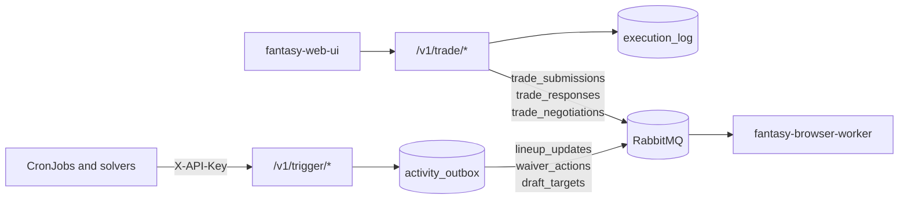

The core API is a FastAPI app. All routes live under `/v1`. The full machine-readable schema, with request and response models, is [`openapi.json`](./openapi.json).

:::note[Regenerating]
The tables below and `openapi.json` are generated from the app. After adding or changing a route, run `DB_PASSWORD=test python scripts/export_openapi.py`. A test fails if either file is stale or a route has no description.
:::

## How requests are authorized

| Caller | Gate |
|---|---|
| Browser users | `oauth2-proxy` in front of `fantasy-web-ui`. The API itself does not check user identity. |
| In-cluster CronJobs and `fantasy-browser-worker` | `X-API-Key` header, checked against `TRIGGER_API_KEY`. |

The `X-API-Key` column marks the routes that enforce the header. Without a configured `TRIGGER_API_KEY`, those routes return 500; with a wrong key, 401.

## Which endpoints act on ESPN

Accepted means queued by the API, not done on ESPN. See [Queue publishing](./queue-publishing.md) for payloads and idempotency.

## Endpoints

<!-- BEGIN GENERATED: endpoints -->

### Trigger

| Method | Path | Purpose | `X-API-Key` | Publishes to |
|---|---|---|---|---|
| `POST` | `/v1/trigger/draft-pick` | Queue the recommended draft pick. | Yes | `draft_targets` |
| `POST` | `/v1/trigger/lineup` | Queue lineup swaps and IR moves. | Yes | `lineup_updates` |
| `POST` | `/v1/trigger/rumor-action` | Evaluate rumor signals now and queue the resulting moves. | No | `lineup_updates`, `waiver_actions` |
| `POST` | `/v1/trigger/waiver` | Queue a waiver claim, optionally held behind an IR move. | Yes | `waiver_actions` |

### Trade

| Method | Path | Purpose | `X-API-Key` | Publishes to |
|---|---|---|---|---|
| `GET` | `/v1/trade/context` | Show current rosters and head-to-head schedule evidence for trades. | No |  |
| `POST` | `/v1/trade/evaluate` | Compute raw VORP delta for a trade. | No |  |
| `GET` | `/v1/trade/incoming` | List incoming trade offers with scores and negotiation state. | No |  |
| `POST` | `/v1/trade/incoming/{espn_transaction_id}/counter` | Queue a counter offer for an incoming offer. | Yes | `trade_negotiations` |
| `POST` | `/v1/trade/incoming/{espn_transaction_id}/decision` | Queue an accept or decline for an incoming offer. | Yes | `trade_responses` |
| `POST` | `/v1/trade/incoming/{espn_transaction_id}/decision/retry` | Queue the same response again after a rejected or unknown attempt. | Yes | `trade_responses` |
| `GET` | `/v1/trade/incoming/{espn_transaction_id}/thread` | Show one offer's negotiation thread. | No |  |
| `POST` | `/v1/trade/incoming/{espn_transaction_id}/triage` | Dismiss or snooze an incoming offer. | Yes |  |
| `GET` | `/v1/trade/offers` | List generated trade proposals with their stored score evidence. | No |  |
| `POST` | `/v1/trade/offers/{offer_key}/approve` | Approve a staged proposal and queue it. | No | `trade_submissions` |
| `POST` | `/v1/trade/score` | Compute the schedule-aware trade score. | No |  |

### Draft day

| Method | Path | Purpose | `X-API-Key` | Publishes to |
|---|---|---|---|---|
| `POST` | `/v1/draft/auto-publish` | Turn draft auto-publish on or off. | No |  |
| `GET` | `/v1/draft/config` | Read the stored live draft config. | No |  |
| `POST` | `/v1/draft/config` | Store the league, team, season and mode for the draft listener. | No |  |
| `GET` | `/v1/draft/logs` | Tail the draft-sync pod log. | No |  |
| `POST` | `/v1/draft/pause` | Pause the auto-publish for a pick. | No |  |
| `DELETE` | `/v1/draft/practice/sync-job` | Delete the practice Job and its Redis state. | No |  |
| `POST` | `/v1/draft/practice/sync-job` | Create a draft-sync Job for a practice room. | No |  |
| `GET` | `/v1/draft/practice/sync-job/status` | Show the practice Job's state. | No |  |
| `POST` | `/v1/draft/resume` | Recompute and republish the recommendation. | No |  |
| `POST` | `/v1/draft/start` | Create the draft-sync Kubernetes Job. | No |  |
| `GET` | `/v1/draft/status` | Show draft board, Job and listener state. | No |  |
| `POST` | `/v1/draft/stop` | Delete a draft-sync Job and its Redis state. | No |  |
| `GET` | `/v1/draft/stream` | Stream draft status as server-sent events. | No |  |

### Activity

| Method | Path | Purpose | `X-API-Key` | Publishes to |
|---|---|---|---|---|
| `GET` | `/v1/activity/actions` | List queued actions with their delivery and verification state. | No |  |
| `GET` | `/v1/activity/actions/{identity}` | Show one action with its event timeline. | No |  |
| `POST` | `/v1/activity/actions/{identity}/check` | Re-verify an action against ESPN now. | No |  |
| `GET` | `/v1/activity/bots` | Summarize each bot's recent activity. | No |  |
| `POST` | `/v1/activity/read/{identity}` | Mark an activity item read. | No |  |
| `GET` | `/v1/activity/sessions` | List bot sessions. | No |  |
| `GET` | `/v1/activity/sessions/{identity}` | Show one bot session. | No |  |

### Roster and waivers

| Method | Path | Purpose | `X-API-Key` | Publishes to |
|---|---|---|---|---|
| `GET` | `/v1/roster/deficits` | Show per-position roster deficits. | No |  |
| `POST` | `/v1/roster/move-preview` | Preview the effect of a roster move. | No |  |
| `GET` | `/v1/waiver/free-agents` | Browse all claimable free agents with metrics and same-position swap values. | No |  |
| `GET` | `/v1/waiver/recommendations` | Recommend waiver adds and drops. | No |  |

### League and matchup

| Method | Path | Purpose | `X-API-Key` | Publishes to |
|---|---|---|---|---|
| `GET` | `/v1/league/current-week` | Show the current NFL week. | No |  |
| `GET` | `/v1/league/player-leaders` | Show top scorers. | No |  |
| `GET` | `/v1/league/standings` | Show league standings. | No |  |
| `GET` | `/v1/league/teams` | List league teams. | No |  |
| `GET` | `/v1/matchup` | Show our matchup for a season and week. | No |  |
| `GET` | `/v1/matchup/roster` | Show a matchup roster with swap and IR suggestions. | No |  |
| `GET` | `/v1/matchup/scoreboard` | Show every matchup's score for a season and week. | No |  |
| `GET` | `/v1/scoreboard` | Same as `/v1/matchup/scoreboard`. | No |  |

### Players and stats

| Method | Path | Purpose | `X-API-Key` | Publishes to |
|---|---|---|---|---|
| `GET` | `/v1/players/search` | Search players by name. | No |  |
| `GET` | `/v1/players/{player_id}/summary` | Show one player's season summary. | No |  |
| `GET` | `/v1/stats/vorp` | List VORP scores. | No |  |

### Backtests

| Method | Path | Purpose | `X-API-Key` | Publishes to |
|---|---|---|---|---|
| `GET` | `/v1/backtest/results` | List backtest runs. | No |  |
| `GET` | `/v1/backtest/results/{season}` | Show the backtest for a season. | No |  |

### Chat and health

| Method | Path | Purpose | `X-API-Key` | Publishes to |
|---|---|---|---|---|
| `POST` | `/v1/chat/query` | Ask the LLM a roster or waiver question. | No |  |
| `GET` | `/v1/health` | Check Postgres and RabbitMQ reachability. | No |  |

<!-- END GENERATED: endpoints -->

## Related

- [Activity submissions](./activity-api.md): how to read an action's delivery and verification state.
- [Incoming trade inbox API](./trade-inbox-api.md): the full contract for the `/v1/trade/incoming` routes.
- [Queue publishing](./queue-publishing.md): queue names, payloads and idempotency keys.
