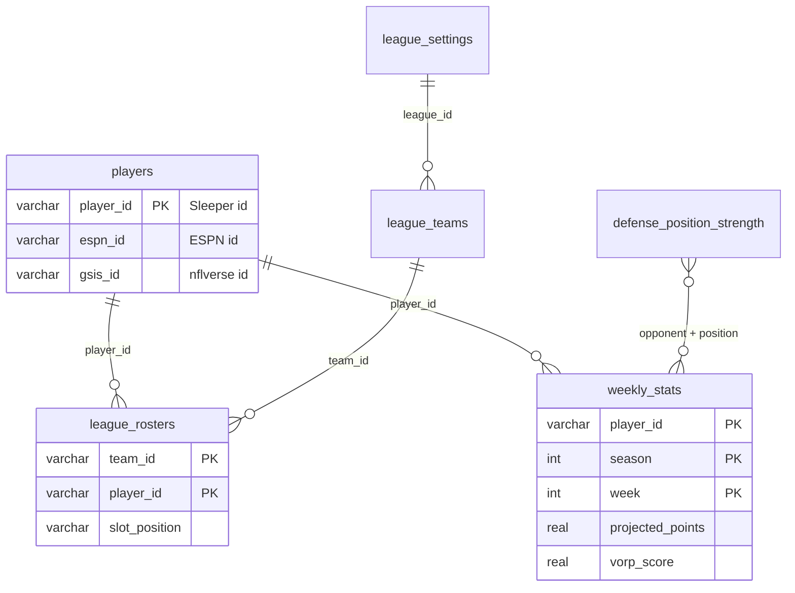
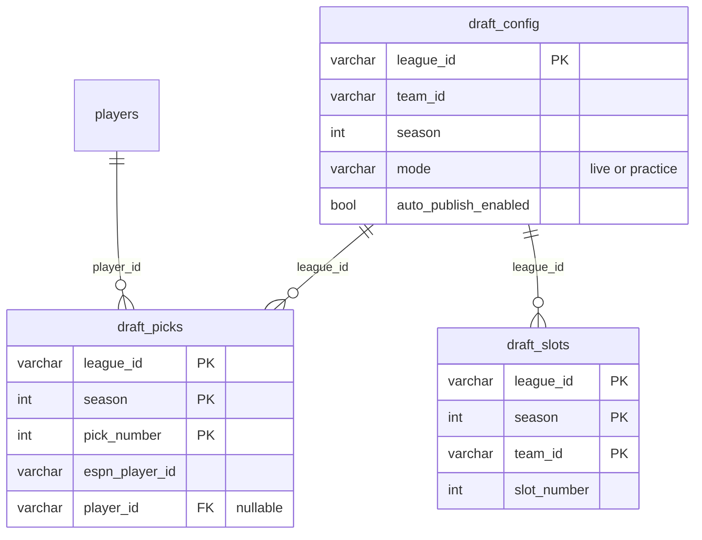
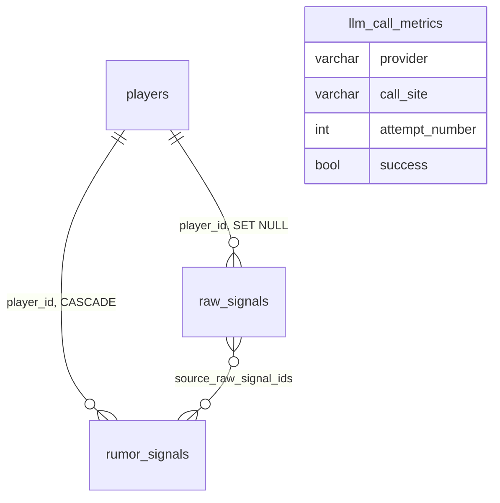
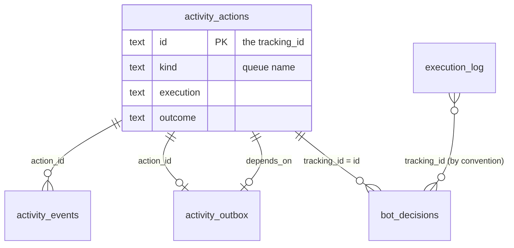
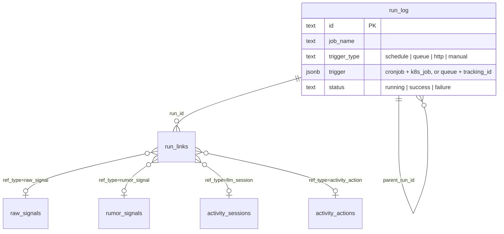
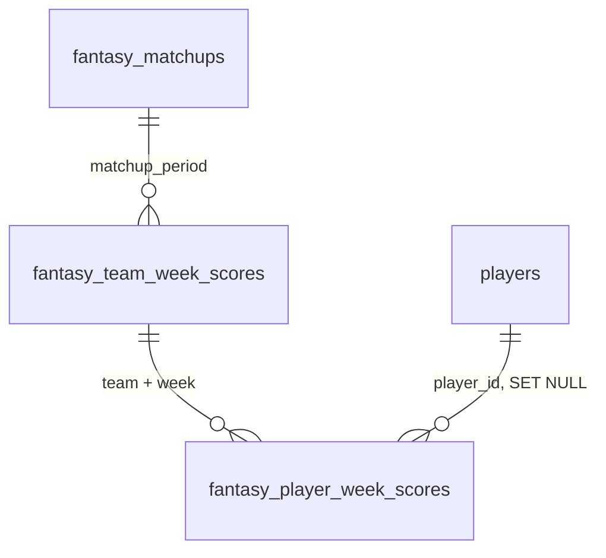

The `fantasy_football` Postgres database holds player metrics, league state, draft state, bot audit trails and queued actions. Core creates every table at API startup; see [Migrations](./migrations.md). The DDL lives in `src/models.py`, plus the `activity_*` tables in `src/services/activity_service.py` and the `run_*` tables in `src/services/run_log_service.py`.

:::tip[Two things to know first]
- `players.player_id` is a **Sleeper** id. ESPN's id is `players.espn_id`. The two id spaces overlap numerically, so never use one where the other is expected.
- `weekly_stats` is keyed by `(player_id, season, week)`. Always filter on `season` as well as `week`.
:::

## How do the tables relate?

### Players, stats and league

`league_rosters.team_id` and `league_teams.team_id` hold the same ESPN team id but have no foreign key.

### Draft day

The relationships here are logical. Only `draft_picks.player_id` has a real foreign key.

### Signals and LLM calls

### Actions and audit trail

`bot_decisions.tracking_id` matches `activity_actions.id` for queued actions, but neither link is a foreign key.

### Run audit log

A worker run's `trigger.tracking_id` is the `activity_actions.id` it executed, which links it to the run that queued that action. Only `run_links.run_id` is a foreign key.

### Score history

## What does each table hold, and who writes it?

"Worker" is `fantasy-browser-worker`. "Core API" means a request handler in this repo. Schedules for the CronJobs are in [Ingestion](./ingestion.md).

### Players and stats

| Table | Holds | Written by |
|---|---|---|
| `players` | One row per player: name, position, team, injury status and the three id spaces. | `sync_players` (Sleeper). `sync_id_crosswalk`, `sync_skill_position_crosswalk` and `sync_kicker_dst` backfill `espn_id` and `gsis_id`. |
| `weekly_stats` | One row per player per week: nflverse usage metrics, projections, actual points and the VORP audit columns. | `metrics_extractor` (usage metrics), `sync_projections` and `sync_kicker_dst` (`projected_points`), `vorp_matrix` (VORP columns), `sync_actual_scores` (`actual_points`). |
| `defense_position_strength` | Last season's points allowed by defense and position, as a z-score. Used only when `MATCHUP_WEIGHTING_ENABLED=true`. | `sync_defense_strength` |

### League

| Table | Holds | Written by |
|---|---|---|
| `league_settings` | Team count, scoring and `lineup_slot_counts` (JSONB). One row per league. | `sync_league` |
| `league_teams` | Team id to display name, plus `ir_slots_used`. | `sync_league` |
| `league_rosters` | Which player sits in which slot on which team, with `is_starter` and ESPN's `espn_injury_status`. | `sync_league`, and a live refresh when the waiver routes find rosters stale. |

### Draft day

| Table | Holds | Written by |
|---|---|---|
| `draft_config` | League, team, season, mode and the auto-publish switch for the draft listener. | Core API (`/v1/draft/*`) and `draft_matrix` (it flips the switch when its circuit breaker trips). |
| `draft_picks` | One row per pick. `espn_player_id` always holds the stream's id; `player_id` is null until the crosswalk resolves it. | `draft_matrix` listener |
| `draft_slots` | Each team's round-1 slot, inferred from pick order. | `draft_matrix` listener |

### Automation and audit

| Table | Holds | Written by |
|---|---|---|
| `execution_log` | One row per worker transaction, plus inbox, response and offer rows. Shared by several writers, so read `transaction_type` first. | Worker. Core also writes `rumor_action_trigger` and `draft_target_publish` rows and updates trade rows. |
| `bot_decisions` | Why an action was taken: the VORP numbers, matchup multiplier and so on. | Core API, in the `/v1/trigger/*` and trade handlers. |
| `activity_actions` | One row per queued action with delivery state (`execution`) and verification state (`outcome`). | Core API and the activity runner. |
| `activity_events` | Timeline of an action's stages. | Core API and the activity runner. |
| `activity_outbox` | Message waiting to be published, with retry state and optional `depends_on` hold. | Core API and the activity runner. |
| `activity_sessions` | LLM chat session transcripts. The runner clears old content. | `llm_history` and the activity runner. |
| `activity_reads` | Which user has read which activity item. | Core API (`POST /v1/activity/read/{identity}`). |
| `rumor_action_checkpoints` | Per-team watermark and in-flight state for rumor actions. | `rumor_action_service` |
| `run_log` | One row per job or bot run: what triggered it, status, error and a `summary`. Purged after `RUN_LOG_RETENTION_DAYS` (90). | `run_log_service.run_scope` in core entrypoints; the worker's `db/run_log.js`. |
| `run_links` | What each run read (`input`) and wrote (`output`): raw signals, rumor signals, LLM sessions, queued actions. | Same as `run_log`, plus the `/v1/trigger/*` handlers via `X-Run-Id`. |
| `trade_candidate_runs` | The latest trade-candidate run per league, season and week: `run_id` (the `run_log` id), `computed_at`, horizon and `counts`. A missing row means the job never ran for that week. | `python -m src.jobs.trade_candidates` |
| `trade_candidates` | One scored package per row for that run: both sides' ESPN ids, positions and player snapshots, `status`, `reasons`, the key score fields and the full trade score in `score`. A run replaces its week's rows in one transaction. | `python -m src.jobs.trade_candidates` |

### Signals and metrics

| Table | Holds | Written by |
|---|---|---|
| `raw_signals` | News and rumor items, deduplicated on `(source, source_item_id)`. | `sync_rumors` |
| `rumor_signals` | The LLM's verdict per player and run. The latest row per player is the current signal. | Worker's rumor digest bot. |
| `llm_call_metrics` | One row per provider attempt, including failed fallbacks. | Core `llm_client`, and the worker's `llm_client.js`. |
| `backtest_results` | One row per backtest run, with a `summary_json` blob. | `src/backtesting/report.py` |

### Score history

| Table | Holds | Written by |
|---|---|---|
| `fantasy_matchups` | One row per team per matchup period. | `sync_actual_scores` |
| `fantasy_team_week_scores` | A team's score for a week, with the ESPN payload. | `sync_actual_scores` |
| `fantasy_player_week_scores` | A player's score on a team for a week, with the ESPN payload. | `sync_actual_scores` |

## What shape is the JSONB?

Several JSONB columns hold different shapes depending on the row. Version strings live inside the value, so a reader can ignore a shape it doesn't recognize.

| Column | Version or key tag | Where it's checked |
|---|---|---|
| `execution_log.counter_offer->'evaluation'` (offers) | `proposal-evaluation-v1` | `trade_offer_service._stored_evaluation` |
| `execution_log.counter_offer->'evaluation'` (inbox) | `incoming-trade-evaluation-v1` | `trade_inbox_service._evaluation` |
| `counter_offer->'score'->scoring_version` | `trade-score-v1` | `trade_score_service.SCORING_VERSION` |
| `counter_offer->>'offer_key'` hash input | `trade-offer-v1` | `trade_offer_service.compute_offer_key` |
| `counter_offer->>'decision_key'` hash input | `trade-response-v1` | `trade_inbox_service.compute_decision_key` |

:::warning
An unrecognized evaluation version or an invalid payload is read as `null` and logged, so a bad row costs one panel, not the whole list. Don't treat `null` as "never scored".
:::

### `execution_log.counter_offer`

Which fields exist depends on `transaction_type`.

| `transaction_type` | Written by | Fields you can rely on |
|---|---|---|
| `trade_offer_submit` | Worker stages it; core approves it. | `offer_key`, `source` (`counter_offer`, `proposal` or `manual`), `from_team_id`, `to_team_id`, `incoming_player_ids`, `outgoing_player_ids`. Optional: `message`, `related_transaction_id`, `thread_root_id`, `evaluation`. |
| `trade_inbox` | Worker refresh; core adds `triage`. | `espn_transaction_id`, `fingerprint`, `proposing_team_id`, `our_team_id`, `send_espn_ids`, `receive_espn_ids`, `proposed_date`, `expiration_date`, `comment`. Optional: `thread_root_id`, `score`, `evaluation`, `triage`, `our_counter`. |
| `trade_response` | Worker | `espn_transaction_id`, `action`, `decision_key`. |

`triage` is `{state, by?, at?, snooze_until?}`, where `state` is `dismissed` or `snoozed`. Field-level detail for the inbox is in [Incoming trade inbox API](./trade-inbox-api.md).

### `execution_log.outcome_details`

Core merges keys into this column with `||`, so existing keys survive.

Trade offer approval (<code>transaction_type = 'trade_offer_submit'</code>)

Stored under the `approval` key when a human approves an offer.

| Field | Meaning |
|---|---|
| `offer_key` | Hash of the offer. |
| `approved_by`, `approved_at` | Who approved, as a UTC ISO timestamp. |
| `tracking_id` | UUID shared with the queued message and `bot_decisions`. |
| `payload` | The exact message published to `trade_submissions`. |
| `publish_error` | Set when the publish failed before sending, so the approval can be retried. |

The row's `status` moves `awaiting_approval` → `approval_pending` → `approved`.

Incoming inbox publications (<code>transaction_type = 'trade_inbox'</code>)

Stored under `incoming_publications`, an object keyed by the publication key (the decision key for accept and decline, a separate key for counters).

| Field | Meaning |
|---|---|
| `kind` | `decision` or `counter`. |
| `status` | `pending` while claiming, then `queued`, or `failed_before_publish`. `queued` means broker-confirmed, not processed by ESPN. |
| `tracking_id`, `approved_by`, `approved_at` | Identity of the request. |
| `fingerprint`, `review_token` | The offer version the human reviewed. |
| `decision_key`, `action` | Present on decisions only. |
| `payload` | The message published, minus `traceparent`. |
| `publish_error` | Set when `failed_before_publish`. |

Recovery rules are in [Incoming trade inbox API](./trade-inbox-api.md).

Rumor action runs (<code>transaction_type = 'rumor_action_trigger'</code>)

Core writes a free-form summary of each run: counts of accepted, duplicate and failed actions, plus the run's `source` (`cli` or `http`). `status` is `success`, `partial_failure` or `failure`.

### `bot_decisions.inputs`

`inputs` holds the justification for one action. `season` and `week` are copied into typed columns for filtering. The keys depend on `action`:

| `action` | `bot_name` | `inputs` keys |
|---|---|---|
| `lineup_swap` | `lineup_bot` | `add_player_vorp_score`, `drop_player_vorp_score`, `matchup_multiplier`, `season`, `week`, and the lineup source: `source_mode`, `source_season`, `source_weeks`, `held_slots`. |
| `lineup_ir_move`, `lineup_ir_activate` | `lineup_bot` | `season`, `week`, `ir_player_vorp_score`, `ir_player_internal_id`, `makes_room_for_player_id`. |
| `waiver_claim` | `waiver_sniper` | `add_player_vorp_score`, `drop_player_vorp_score`, `season`, `week`; with an IR move, also `ir_player_vorp_score`, `ir_player_internal_id`. |
| `draft_pick` | `draft_clicker` | `vorp_score` (scarcity-adjusted), `season`. |
| `trade_offer` | `trade_builder` | `season`, `execution_log_id`, plus the approval fields. |
| `trade_inbox_decision_*`, `trade_inbox_counter` | `trade_inbox` | `season`, `week`, `execution_log_id`, plus the publication claim. |

:::note
The column is `inputs`, but request payloads call the same object `decision_inputs`. `target_player_id` and `drop_player_id` are not foreign keys and hold ESPN ids. Rows written before lineup ids were switched to ESPN ids hold internal Sleeper ids for `lineup_swap`.
:::

### Other JSONB columns

| Column | Shape |
|---|---|
| `league_settings.lineup_slot_counts` | Slot name to count, such as `{"QB": 1, "RB": 2, "BE": 6, "IR": 1}`. The `BE` count drives bench size. |
| `league_settings.scoring_settings` | ESPN's scoring settings, as synced. |
| `backtest_results.summary_json` | The full lineup, waiver and draft breakdown behind the point totals. |
| `fantasy_*_week_scores.payload` | The raw ESPN scoring payload kept for audit. |
| `activity_actions.payload`, `.evidence` | The queued message body, and what verification found. Secret-looking keys are redacted from the stored payload. |
| `activity_events.detail` | Per-stage detail. Dependency events carry `depends_on`, and failures add `reason`. |
| `rumor_action_checkpoints.state` | `{watermark, signals, actions, failed_jobs}`. |
| `trade_candidate_runs.counts` | `{enumerated, prefiltered, scored, proposable, needs_drop, one_sided, teams: [{team_id, name, proposable, needs_drop, one_sided}]}`. |
| `trade_candidates.score` | The `POST /v1/trade/score` response for the package, as scored at `computed_at`. `send_players` / `receive_players` hold `{espn_id, player_id, name, position, nfl_team, vorp, nfl_bye_week}`. |
| `run_log.trigger` | Scheduled or manual Jobs: `{cronjob, k8s_job}`. Worker runs: `{queue, tracking_id}`. HTTP: `{route}`. |
| `run_log.summary` | Always: `log_tail` (the run's last 50 INFO+ log lines, library noise excluded), `warnings`, `errors` and `last_message`. Jobs add their own counters and an optional one-line `headline`, such as the rumor syncer's `fetched`/`new`/`per_source` or the rumor action trigger's `RunOutcome` details. |

## Related

- [Migrations](./migrations.md): how these tables are created and changed.
- [Read-only access](./read-only-access.md): querying them without write rights.
- [API reference](./api-reference.md): the endpoints that read and write them.
