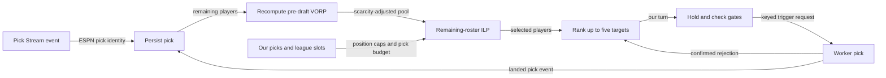

The draft matrix selects an ideal remaining roster, then chooses the next pick from that selection. Use this page to understand positional needs, candidate order and clock-limited publication.



## Which players and capacity are available?

| Input | Rule |
| --- | --- |
| Pick events | Redis `draft_picks:{leagueId}` consumer group |
| Identity | Resolve ESPN IDs through the player crosswalk; persist picks |
| Pool | Requested season/week projections, week 1 by default |
| Exclusion | Already in `draft_picks`; not post-draft roster ownership |
| VORP | Recompute coefficient, structural baselines and scarcity over the undrafted pool |
| Capacity | Configured starters plus BE; exclude IR |
| Missing BE setting | Total roster-size fallback 16 |
| FLEX | Default RB/WR/TE shares, largest-remainder rounding |
| Bench | Same RB/WR/TE shares |

```text
starting_need[position] = max(0, positional_slots + FLEX_share − drafted_by_us)
position_cap[position] = max(0, positional_slots + FLEX_share + bench_share − drafted_by_us)
target_picks = min(remaining_picks, pool_size,
                   Σ min(position_cap[position], available_count[position]))
```

## How is the immediate target selected?

| Step | Rule |
| --- | --- |
| Remaining-roster ILP | Maximize total scarcity-adjusted VORP with exactly `target_picks` and position upper caps |
| Required negative-value picks | Equality forces picks even when all values are zero/negative |
| Empty pool, zero capacity or non-optimal solve | No recommendation |
| First ranking tier | Selected players at positions still needing starters; descending VORP |
| Second ranking tier | Remaining selected players; descending VORP |
| Candidate limit | Five; no additional equal-score preference |

:::tip[Starter need comes first]
A lower-valued needed starter can precede a higher-valued bench candidate. The immediate pick comes from the selected remaining-roster solution, not from the whole pool's highest score.
:::

## When does the listener recompute?

| Event | Behavior |
| --- | --- |
| Startup | Seed VORP lookup; recover this consumer's unacknowledged backlog |
| Opponent pick | Recompute when our turn is next under the known snake order |
| Our confirmed pick | Record whether it matched the attempted target |
| New filled pick | Cancel stale pending publisher |
| Draft complete | Stop listener |
| Processed Stream event | Acknowledge after processing |

The Redis board records recommendation, candidates, VORP lookup and listener/timer evidence.

## What limits auto-publication?

| Setting or gate | Default behavior |
| --- | --- |
| Hold delay | 8 seconds |
| Pick clock | 90 seconds, measured from upstream Stream event |
| Safety margin | 5 seconds |
| Minimum auto-publish window | 10 seconds; clamp delay to available window |
| Pause/autodraft/mode | Gate the publisher |
| Transient failure | Retry every 2 seconds within the clock |
| Three consecutive failed publications | Trip auto-publish circuit breaker |
| Next pick cycle | May re-enable circuit-breaker disable; preserve manual disable |
| Confirmed ESPN rejection | Advance to next precomputed candidate after readback |

:::warning[Do not treat uncertainty as rejection]
Backlog processing does not restart the clock. A recommendation, queued target and landed ESPN pick are separate evidence; uncertainty does not authorize choosing another player.
:::

<details>
<summary>Listener CLI arguments</summary>

The API normally provisions the listener Job. For a direct invocation, IDs must name the intended draft.

| Argument | Requirement |
| --- | --- |
| `--league-id` | Required |
| `--team-id` | Required |
| `--season` | Required |
| `--week` | Optional; default 1 |
| `--auto-draft-delay-seconds` | Optional |

</details>

## Related

- [Pre-draft VORP](projections-and-vorp.md)
- [Historical draft comparisons](backtesting.md)
- Implementation: [draft_matrix.py](https://github.com/cvillarr23/fantasy-core-pipeline/blob/main/src/optimization/draft_matrix.py)
