The incoming inbox ranks stored offers and exposes evidence for human review. Use this page to distinguish ranking, shadow verdicts and authorized responses.

```mermaid
flowchart LR
    E[ESPN incoming offers] -->|parse and fingerprint| W[Worker refresh]
    W -->|score request| S[Core trade scorer]
    S -->|summary and full evidence| I[(Stored inbox)]
    I -->|filters and ranking| L[Core inbox read]
    L -->|offer and review token| H[Human review]
    H -->|decision or counter| G[Locked publication checks]
    G -->|approved request| Q[Broker]
    Q -->|fresh ESPN checks| R[Worker response and verification]
```

## How are offers ranked?

| Priority or filter | Rule |
| --- | --- |
| Score | Stored numeric `score.final_score`, descending; numeric scores precede unscored offers |
| Tie-breaks | Expiration, proposal date, transaction ID as a string |
| Invalid/missing dates | Sort last |
| Stale/incomplete evidence | Does not demote a numeric score |
| Raw delta VORP | Single-week evidence; never ranks entries |
| Pagination | Filter and rank first, then paginate |
| Default live states | `open`, `unparsed`, `responding` |
| Hidden | Dismissed, or snoozed strictly beyond now |

At the snooze deadline, an offer becomes visible without a write. Invalid or missing snooze dates do not hide it.

## Shadow policy

Worker `shadow-v1` records hypothetical threshold verdicts for calibration. No publication path reads that verdict to authorize a response.

| Condition | Verdict |
| --- | --- |
| No finite thresholds | None |
| Both thresholds set and accept minimum ≤ decline maximum | None: invalid thresholds |
| No numeric score, stale score, unmapped traded players | None |
| Roster overage or non-player partial reasons | None |
| `final_score >= accept_min` | Would accept |
| `final_score <= decline_max` | Would decline |
| Between thresholds | None |

:::note[Incomplete horizon alone does not cause abstention]
Inspect [trade coverage](trade-scoring.md#how-should-you-read-incomplete-scores) even when the shadow policy predicts an action. A verdict is advisory, not approval.
:::

## Which evidence can you trust?

| Field | Role |
| --- | --- |
| `score` | Validated flattened score summary; unknown/invalid versions return null |
| `evaluation` | Full score request/response bound to the same offer, refresh and summary |
| `review_token` | Opaque token for the exact terms and proposer note you reviewed |
| `publications` | Core claims and broker receipts |
| `response`, `decision` | Worker execution and verification evidence |
| `last_seen_at` | Per-offer refresh time, not a global job heartbeat |

The full evaluation is display-only: it does not affect ranking, review tokens or publication checks. Core withholds malformed or mismatched evidence instead of presenting a breakdown that disagrees with the summary.

## What can you authorize?

| Action | Checks and effect |
| --- | --- |
| Triage | Update visibility in any inbox state; no ESPN response |
| Accept | Open parsed offer, more than five minutes before expiry, matching score fingerprint, no roster overage |
| Decline | Same actionable-offer checks; no score required |
| Counter | Matching score fingerprint/week and complete player mapping; queue negotiation for later outgoing approval |
| Retry | Explicit human request naming the only blocking `rejected` response, or `response_unknown` with verified-not-answered evidence |

Decision, counter and retry verify the review token under the offer lock before any claim or broker access. If the offer changed, core returns 409; you must read and review it again.

:::warning[Unknown outcomes stay blocked]
A publication never proves ESPN execution. The worker rechecks identity, approval, live roster and expiry; core does not automatically retry blocked or rejected responses.
:::

## Related

- [Complete API contract and recovery rules](incoming-trade-api.md)
- [Trade context](trade-context.md)
- [Trade scoring](trade-scoring.md)
- [Outgoing counters and approval](outgoing-trades.md)
- Implementation: [trade_inbox_service.py](https://github.com/cvillarr23/fantasy-core-pipeline/blob/main/src/services/trade_inbox_service.py), [worker shadow policy](https://github.com/cvillarr23/fantasy-browser-worker/blob/main/src/lib/trade_inbox.js)
