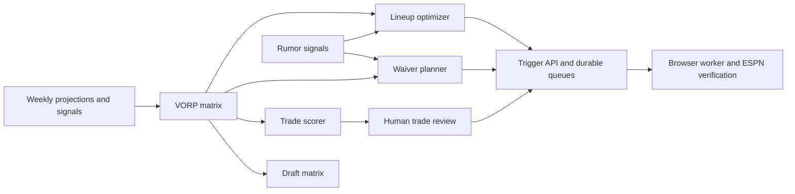

These pages describe the implemented inputs, formulas, thresholds and outputs. Values are fantasy-point-based VORP unless stated otherwise. Internal `player_id` and ESPN IDs are separate namespaces; publication requires an explicit mapping.

| Decision | Read next |
| --- | --- |
| Projection adjustments and replacement value | [Projections and VORP](projections-and-vorp.md) |
| Starting slots and published swaps | [Lineup optimization](lineup-optimization.md) |
| Drop candidates, IR and claims | [Waivers](waivers.md) |
| Fantasy strength and schedule evidence | [Trade context](trade-context.md) |
| Before/after starter value and G*, C* | [Trade scoring](trade-scoring.md) |
| Evaluation, staging and approval | [Outgoing trades](outgoing-trades.md) |
| Ranking, shadow policy and review evidence | [Incoming trades](incoming-trades.md) |
| Event-triggered decisions and durable retries | [Rumor actions](rumor-actions.md) |
| Pick selection and draft clock | [Draft](draft.md) |
| Historical comparisons and running a replay | [Backtesting](backtesting.md) |

A recommendation is an output of evaluation. A queued/approved receipt confirms publication to the control plane or broker; the browser worker owns execution and ESPN readback. Inspect [Activity](../activity-api.md) and worker evidence to establish the final result.
