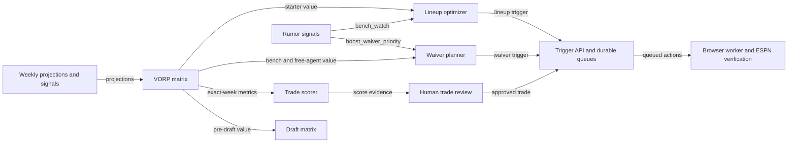

Use these guides to predict a decision from its inputs, formulas and thresholds. Start with the pipeline you want to understand, then follow its links to evidence and execution rules.

| Decision | Read next |
| --- | --- |
| Projection adjustments and replacement value | [Projections and VORP](projections-and-vorp.md) |
| Starting slots and published swaps | [Lineup optimization](lineup-optimization.md) |
| Drop candidates, IR and claims | [Waivers](waivers.md) |
| Fantasy strength and schedule evidence | [Trade context](trade-context.md) |
| Before/after starter value and G*, C* | [Trade scoring](trade-scoring.md) |
| League-wide candidate packages | [Trade candidates](trade-candidates.md) |
| Evaluation, staging and approval | [Outgoing trades](outgoing-trades.md) |
| Ranking, shadow policy and review evidence | [Incoming trades](incoming-trades.md) |
| Event-triggered decisions and durable retries | [Rumor actions](rumor-actions.md) |
| Pick selection and draft clock | [Draft](draft.md) |
| Historical comparisons | [Backtesting](backtesting.md) |
| Replay commands and verification | [Run a backtest](run-backtest.md) |
| Incoming endpoint/payload lookup | [API reference](incoming-trade-api.md) |

:::note[Identity and completion]
Internal `player_id` and ESPN IDs are separate namespaces; publication requires a mapping. Values are fantasy-point-based VORP unless stated otherwise.
:::

:::tip[Find the final result]
A queued/approved receipt confirms publication to the control plane or broker. Inspect [Activity](../activity-api.md) and worker ESPN readback to establish execution.
:::
