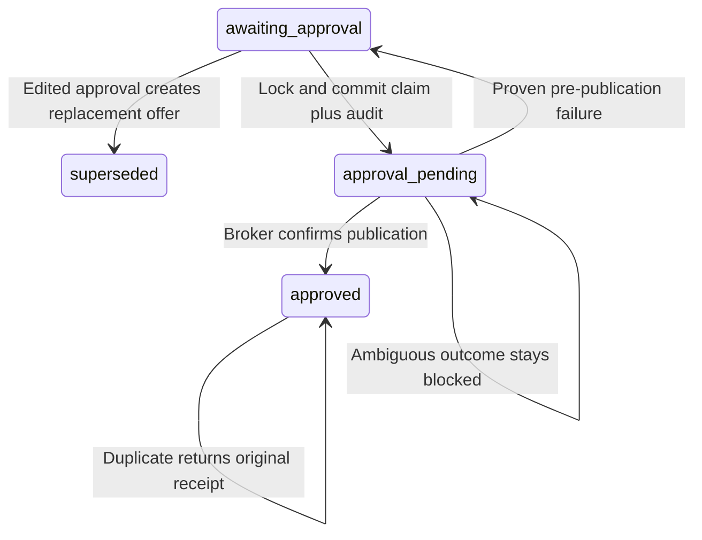

Outgoing proposals use deterministic scoring before staging an offer for human approval. Use this page to understand package ranking and the difference between an approved receipt and an ESPN submission.

```mermaid
flowchart LR
    D[Deficit targets] -->|up to three teams| L[LLM packages]
    L -->|at most six packages| V[Validate IDs and ownership]
    V -->|four-week requests| S[Core trade scorer]
    S -->|eligible scores| R[Worker ranking]
    R -->|winning evidence| P[Grounded pitch]
    P -->|offer and evaluation| A[Stage for human approval]
    A -->|approved offer key| Q[trade_submissions queue]
    Q -->|execution gates| W[Worker and ESPN]
```



## Which evaluation do you need?

| Evaluation | Inputs | Output |
| --- | --- | --- |
| `POST /v1/trade/evaluate`; MCP `evaluate_proposed_trade` | Internal incoming/outgoing IDs, exact season/week | Raw VORP totals and missing IDs |
| [Trade score](trade-scoring.md) | ESPN IDs, current ownership, horizon and schedules | Optimal starter impact, G*, C* and coverage |

```text
incoming_total = sum(available incoming VORP)
outgoing_total = sum(available outgoing VORP)
delta_vorp = incoming_total − outgoing_total
```

Duplicate IDs and IDs on both sides are rejected. Absent rows contribute nothing and appear in `missing_player_ids`; raw evaluation does not simulate slots, schedules or drops.

## Which generated packages qualify?

The worker targets up to three deficit teams and asks for at most six packages. Our outgoing side must include the target's deficit position.

| Gate | Requirement |
| --- | --- |
| Identity | Distinct, correctly owned ESPN IDs; no side overlap |
| Coverage | At least one scored week; no unmapped traded players |
| Our gain | Raw lineup gain >0 |
| Their gain | Raw lineup change ≥0 |
| Capacity | Neither side exceeds its roster limit |
| Final score/horizon | Positive weighted score and complete horizon are not required |

No eligible package means no staged offer. Unavailable scoring can fail the run rather than stage an unscored claim.

## How does the worker rank packages?

| Priority | Rule |
| --- | --- |
| 1. Score tier | Numeric `final_score` packages precede unweighted `our_lineup_gain` packages |
| 2. Value | Chosen score divided by scored-week count, descending |
| 3. Tie-breaks | More scored weeks, complete horizon, larger counterparty gain, then canonical package key |

Incoming inbox ranking uses total final score instead. The outgoing ranking keeps weighted and unweighted values in separate tiers.

<details>
<summary>Pitch, staged evidence and offer identity</summary>

| Evidence | Contents |
| --- | --- |
| Pitch | Deterministic score facts with cited evidence IDs |
| `proposal-evaluation-v1` | Exact request/response, target deficit, ranking basis/value/counts and pitch evidence paths |
| Pitch paths | JSON Pointers into the stored score |
| Invalid/absent evaluation | Unavailable panel; no inference from LLM text |
| `GET /v1/trade/offers` IDs | ESPN IDs even in `incoming_player_ids`/`outgoing_player_ids` |
| `offer_key` | Digest of identity, player sides, exact message and related transaction ID for counters |
| Thread root | Tracing metadata outside the digest |

Editing the message at approval creates a new key over the exact edited text. Core checks configured league/team, player sides and source; conflicting staged copies fail closed.

</details>

## What happens when you approve?



| Rule | Behavior |
| --- | --- |
| Route | `POST /v1/trade/offers/{offer_key}/approve` |
| Approver | Nonblank self-reported `approved_by` audit label |
| Optional message | `message`: nonblank after whitespace check; changed text is limited to 1000 characters; exact text is preserved |
| Authentication | No application-layer auth; deployment trust boundary applies |
| Lock | Read all rows for key under PostgreSQL advisory lock |
| Eligible state | `awaiting_approval` |
| Blocking history | Pending, submitting or submitted row prevents new publication |
| Committed before send | Exact payload, approver, time, tracking ID and `bot_decisions` audit |
| New confirmed publication | 202, `approved` |
| Duplicate approval | 200, original receipt, no send |

An omitted or null `message`, or text exactly equal to the staged message, keeps the
original key and approval behavior. For changed text, core creates a replacement row,
marks all staged copies of the original key `superseded`, and commits the replacement
claim and audit in the same transaction. The published payload contains the edited
`message` and approval for the new key; the response's `offer_key` is that new key.
An existing offer under the edited key returns 409 rather than merging histories.

`GET /v1/trade/offers?status=approved` exposes `drafted_message` (the original generated
text, which can be null) and `message_edited: true` on edited rows. Unedited rows return
`drafted_message: null`, `message_edited: false` and `edited_by: null`. Edited rows expose
`edited_by`, the self-reported label of the person who changed the message.
`approval.approved_by` identifies the latest successful approver; after a proven failed
publish, a different person may re-approve without changing the editor.
`evaluation.pitch` remains the generated, evidence-backed draft. Human edits are not
validated against score evidence and do not change the stored evaluation.

Repeating the same edited approval through either the original or new key returns 200
with `duplicate: true`, the new key and the original receipt. Omitting the message on
either key also returns that receipt. A different message after approval returns 409.
Pending or ambiguous publication remains blocked. A proven pre-publication failure can
retry the same edited offer through either key; the original draft stays superseded.
Echoing the original draft through the original key also returns the replacement receipt,
even when that draft exceeds 1000 characters. Confirmed duplicate receipts through the
original key do not require the edited-key lock, so a worker claim does not block them.
A busy edited-key lock still returns retryable 409 when a new publication is needed.
If a later scan stages the original key again, its live staged row takes precedence over
the historical redirect and can be approved independently.

The 1000-character limit is a fallback pending the ESPN request capture in
[fantasy-browser-worker#124](https://github.com/cvillarr23/fantasy-browser-worker/issues/124).
Blank or oversized text returns 422 before changing any rows.

:::warning[An approved receipt is a broker receipt]
Worker enable, dry-run, approval and execution gates still apply. For an ambiguous send or crash, reconcile broker, worker and ESPN evidence before releasing the indefinitely pending claim.
:::

## Related

- [Incoming counters and review](incoming-trades.md)
- [Trade context](trade-context.md)
- Core: [trade_service.py](https://github.com/cvillarr23/fantasy-core-pipeline/blob/main/src/services/trade_service.py), [trade_offer_service.py](https://github.com/cvillarr23/fantasy-core-pipeline/blob/main/src/services/trade_offer_service.py)
- Worker: [proposal generator](https://github.com/cvillarr23/fantasy-browser-worker/blob/main/src/bots/trade_proposal.js), [package ranking](https://github.com/cvillarr23/fantasy-browser-worker/blob/main/src/lib/trade_scoring.js)
