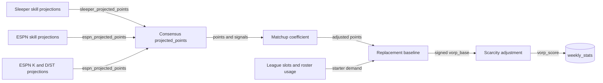
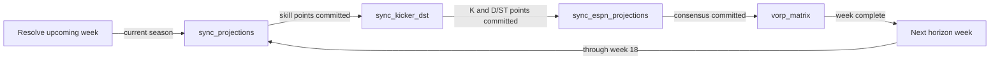

VORP measures a player's projected value above a replacement player. Use this page to predict how weekly inputs change lineup, waiver and draft values.



## When does the refresh run?

| Setting | Behavior |
| --- | --- |
| Schedule | Daily at 18:00 America/Chicago |
| Season | `CURRENT_YEAR` |
| Horizon | Upcoming week through `min(week + 3, 18)` |
| Week budget | 600 seconds shared across four stages |
| Target-week failure | Stop; fail the Job |
| Future-week failure | Skip that week's remaining stages; try other weeks; fail the Job |
| Completed work | Keep committed weeks; no automatic whole-run retry |



The resolver chooses the earliest regular-season week with an unfinished game. A finished Thursday game does not advance the week.

<details>
<summary>Week resolution and ingestion edge cases</summary>

| Condition | Result |
| --- | --- |
| Schedule download fails | Six attempts; backoff 5, 10, 20, 30, 30 seconds; then fail |
| Missing schedule or stale season configuration | Fail rather than guess |
| Current regular season complete | No upcoming week; scheduled jobs exit successfully |
| Explicit API week | Use the requested week; trade horizons stop at the league's regular-season end |
| Sleeper scoring field missing/null | Store 0 for a known player |
| Player absent from response or unknown locally | Do not create a projection row |

`sync_projections` reads regular-season `pts_ppr` for QB/RB/WR/TE and upserts only `sleeper_projected_points`, preserving advanced metrics. `sync_kicker_dst` supplies ESPN K/D-ST projections.

</details>

## Which projection does VORP use?

`projected_points` is the consensus (#462): the mean of the non-null `espn_projected_points` and `sleeper_projected_points` (`src/projection_consensus.py`). Each sync writes only its own source column, then recomputes `projected_points` in the same transaction. Everything downstream reads `projected_points`, so VORP, the lineup solver, waivers, trade scoring and the roster/matchup pages all see the same number.

| Situation | `projected_points` |
| --- | --- |
| Both sources | Their mean |
| Sleeper only (the ESPN sync hasn't run or failed, or ESPN didn't return the player) | Sleeper's value |
| Sleeper lists the player without a number | 0.0, as before #462; both sources are NULL |
| ESPN only (K and D/ST) | ESPN's value |
| Neither source (rows from before #462, metrics-only and backtest rows) | Left as it was |

`sync_espn_projections` only updates rows with a Sleeper value (`sleeper_projected_points IS NOT NULL`). It never inserts one, so which players have a row (and "no row means bye") stays Sleeper's call, and the free-agent replacement pool doesn't grow. A player ESPN doesn't project that week, or whose team is on bye per the NFL schedule, gets `espn_projected_points = NULL` and falls back to Sleeper. Players are matched by `players.espn_id` only.

The ESPN stage is optional in the refresh. It fetches one position at a time with a 30-second request timeout, and an empty or short position (fewer than 32 QB, 64 RB, 96 WR or 32 TE) fails the run before anything is written, so a bad response never clears stored ESPN values. The refresh logs a failed or timed-out ESPN stage (capped at 180 seconds) and still runs `vorp_matrix` on the Sleeper fallback.

On the first run after deploy, every horizon week's skill rows are rewritten once (`projected_points` moves from Sleeper's value to the mean), and that week's `vorp_matrix` shifts VORP to match. Nothing needs a manual fix: lineups, waivers and the matchup page read the new values directly, and trade scores and trade candidates built on Sleeper-only values are recomputed on the next scan.

The ESPN market multiplier (`ESPN_MARKET_WEIGHT`) is unchanged and still applies after the baseline, to `vorp_base`. ESPN's view now enters twice: as half of the projection, and as the start% adjustment. The two are separate signals (ESPN's model and managers' start decisions), and the weight bounds the second one.

## How is VORP calculated?

```text
coefficient = clamp(1 + 0.06 × market_z + 0.03 × signal_z, 0.85, 1.15)
adjusted_projected_points = projected_points × coefficient
vorp_base = adjusted_projected_points − replacement_baseline[position]
expected_depth = max(1, round(0.5 × league_starting_demand[position]))
ratio = clamp(positive_VORP_free_agent_count / expected_depth, 0, 1)
scarcity_multiplier = 1 + 0.35 × (1 − ratio)
vorp_score = vorp_base × applicable_scarcity_multiplier
market_multiplier = clamp(1 + w × (start_pctile − 0.5), 1 − w/2, 1 + w/2)
vorp_score = vorp_score + |vorp_score| × (market_multiplier − 1)
```

| Input | Rule |
| --- | --- |
| `market_z` | Standardize distinct NFL team implied totals within season/week |
| `signal_z`: QB | Standardize negative pressure rate allowed |
| `signal_z`: WR/TE | Standardize separation |
| `signal_z`: RB | Standardize depth-chart improvement |
| Signal groups | Position/season/week; clamp z to ±2 |
| Missing/degenerate signal | Contribute 0 for null, fewer than two observations or zero standard deviation |
| Usage shares | Excluded because projections already include usage |
| Scarcity eligibility | Only unrostered players with positive base VORP; everyone else uses 1.0 |
| `w` | `ESPN_MARKET_WEIGHT`, default `0.0` in code. At 0 the market step is skipped and `vorp_score` is unchanged. Production sets `0.2` in fantasy-infra's `fantasy-league-config`, chosen by `market_weight_sweep` over 2023-2025 (#398); TODO(#410): recheck against real ESPN snapshots |
| `start_pctile` | The market score ranked within position (ties averaged), scaled to 0..1; 0.5 when a position has one known value |
| Market score, live (`espn`) | ESPN `percent_started`: each player's latest `espn_player_ownership` week at or before the target week, same season |
| Market score, backtest (`ecr`) | Negated FantasyPros weekly positional ECR (rank 1 scores highest) from the latest `fp_weekly_ecr` scrape week at or before the target week. Both sources share one percentile function |
| Missing market data | `market_multiplier` = 1.0 |
| Negative `vorp_score` | The adjustment scales the magnitude, so a higher start% always raises the score and a multiplier of 1 changes nothing |
| Market in backtests | `season_replay --espn-market-weight` (default 0.0) and `--market-source` (`espn` or `ecr`); replays never read the env var. `market_weight_sweep` chooses the weight |

:::tip[Predict the result]
12 adjusted points minus an 8-point baseline gives 4 VORP, or 5.4 at maximum scarcity. A 6-point player stays at −2, even when the position is thin.
:::

## Where is the replacement line?

| Roster state | Baseline |
| --- | --- |
| Populated rosters | Highest adjusted projection among free agents (unrostered) at the position; other teams' benches are not candidates |
| Populated rosters, no free agent at the position | Structural rank N+1 |
| Pre-draft | First player beyond structural starter demand: rank N+1 |
| Pool shorter than demand | Pool minimum |
| Empty position pool | QB 10; RB/WR 8; TE 5; K/D-ST 7 |

<details>
<summary>Starter demand, FLEX allocation and default league shape</summary>

Starter demand is positional slots × team count plus allocated FLEX slots.

| Allocation input | Rule |
| --- | --- |
| FLEX types | RB/WR/TE, RB/WR, WR/TE; restrict positions to the slot |
| At least ten observed eligible FLEX rows | Use observed position shares |
| Fewer than ten rows | RB 0.5, WR 0.4, TE 0.1; restrict and normalize |
| Integer rounding | Largest remainder; allocations sum to total FLEX demand |
| Missing league settings | Ten teams; QB 1, RB 2, WR 2, TE 1, RB/WR/TE 1 |

</details>

## What happens with missing data?

The pipeline updates existing exact-week rows with the coefficient, adjusted points, base VORP, scarcity, final VORP and defense multiplier. An empty week returns zero updates.

:::warning[Refresh coverage is not guaranteed]
A four-week refresh attempt does not guarantee four scored weeks. Trade scoring requires exact-week metrics; lineup and waiver reads have separate fallback rules.
:::

| Defense adjustment | Behavior |
| --- | --- |
| `MATCHUP_WEIGHTING_ENABLED=true`, week 1 | `clamp(1 + 0.05 × opponent_defense_strength_z, 0.9, 1.1)` |
| Missing strength | Neutral 1.0 |
| Disabled or another week | Persist null; lineup consumes it as 1.0 |
| Effect | Lineup objective only; canonical VORP stays unchanged |

Positive defense strength means a weaker defense.

## Related

- [Lineup data rules](lineup-optimization.md)
- [Waiver data rules](waivers.md)
- [Trade coverage](trade-scoring.md)
- Implementation: [vorp_matrix.py](https://github.com/cvillarr23/fantasy-core-pipeline/blob/main/src/optimization/vorp_matrix.py), [sync_projections.py](https://github.com/cvillarr23/fantasy-core-pipeline/blob/main/src/ingestion/sync_projections.py), [nfl_schedule.py](https://github.com/cvillarr23/fantasy-core-pipeline/blob/main/src/nfl_schedule.py)
- Schedule: [infra refresher](https://github.com/cvillarr23/fantasy-infra/blob/main/base/core-pipeline/draft-prep-refresher-cronjob.yaml)
