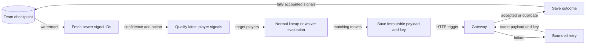

Qualifying rumor signals rerun the normal lineup or waiver rules. Use this page to see why a signal produced an action, no move or a deferred retry.

## Which signals can act?

| Rule | Behavior |
| --- | --- |
| Read order | Increasing signal ID after the team's durable watermark |
| Confidence | At least `RUMOR_ACTION_CONFIDENCE_THRESHOLD`; default 0.75 |
| Duplicate player/action | Latest qualifying signal in the batch wins |
| Low-confidence/non-action rows | Still account for them so they cannot stall the cursor |

| Suggested action | Evaluation | Published subset |
| --- | --- | --- |
| `boost_waiver_priority` | Normal live waiver pools, >3 margin and IR gates | Moves adding a signaled player |
| `bench_watch` | Shared pregame lineup evaluation | Swaps removing a signaled current starter |

:::note[News does not override the optimizer]
Rumors add no score bonus and force no move. A qualifying signal with no normal-rule improvement becomes `no_beneficial_move`; unrelated moves wait for scheduled evaluation.
:::

Decision evidence adds signal ID, sentiment and confidence to VORP/source evidence. Missing inputs and identities are separate outcomes from no improvement.

## What survives a restart?

| Checkpoint field | Purpose |
| --- | --- |
| Team and version | PostgreSQL ownership; optimistic version check rejects overlapping updates |
| Watermark | Last contiguous fully accounted signal ID |
| Signal progress | Preparation, action links and recorded reasons |
| Prepared actions | Immutable payload, stable gateway key, attempt times and outcomes |
| Failed-job markers | Retain job failure state for seven days |

Preparation commits before HTTP publication. A crash after delivery replays the same key; database transactions never span gateway calls.

The legacy Redis `rumor_action:last_processed_id` initializes the first team checkpoint, then becomes a best-effort mirror. Pending work stops the watermark; accepted and already-queued outcomes both complete an action.

## When does retry stop?

| Work | Limit |
| --- | --- |
| Publication | Three failures |
| Signal evaluation | Three failures and 24 hours |
| Waiver action | 24-hour retry window |
| Lineup action | 20-minute retry window; gateway key lasts 30 minutes |
| Different season/week | Drop prepared action rather than replay |
| Saved IR + add | Recheck `AUTO_PUBLISH_IR_MOVES` at delivery |

Terminal failures retain reasons in execution evidence. Completed checkpoint entries can be pruned below the watermark.

## How do you inspect the outcome?

| Result | Meaning |
| --- | --- |
| Returned claims/swaps | Newly published actions, plus watermark |
| `success` | All work accounted for, including no-op or duplicate outcomes |
| `partial_failure` / `failure` | Unaccounted work, missing identity or publication failure |
| Already queued | Gateway recognized an earlier publication; not proof of ESPN execution |

Inspect signal/action counters and drop reasons in [Activity](../activity-api.md) before attempting recovery.

## Related

- [Lineup rules](lineup-optimization.md)
- [Waiver and IR gates](waivers.md)
- Implementation: [rumor_action_service.py](https://github.com/cvillarr23/fantasy-core-pipeline/blob/main/src/services/rumor_action_service.py), [rumor_action_checkpoint.py](https://github.com/cvillarr23/fantasy-core-pipeline/blob/main/src/services/rumor_action_checkpoint.py)
