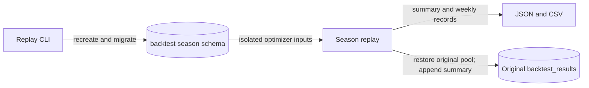

Run a standalone replay against a development database to compare historical decision results. Read [Backtesting](backtesting.md) before interpreting its scores.

:::warning[Prerequisites]
Install the repo's dependencies and configure `DB_HOST`, `DB_NAME`, `DB_USER` and `DB_PASSWORD` for a reachable development PostgreSQL database with schema creation privileges. Each run wipes `backtest_<season>`; run in a standalone process because its temporary connection-pool swap must not overlap API requests or another replay.
:::

## Run the replay

1. Open a terminal in the repo root.
2. Run the season replay:

   ```bash
   python -m src.backtesting.season_replay --season 2024
   ```

3. Verify the JSON summary and weekly CSV in `backtest_output/2024/`.
4. Verify the appended summary through the backtest results API or the development database's `backtest_results` table.



The command downloads historical data and writes reports without publishing actions to ESPN. The original connection pool is restored after the isolated replay.

## Troubleshoot the run

| Symptom or need | Action |
| --- | --- |
| Cannot connect or create schema | Check development DB settings and schema privileges |
| Earlier replay data disappeared | Re-running wipes that season's isolated schema; inspect persistent reports/summaries |
| Need a shorter replay or custom output | Call `run_season_replay` with `weeks`, `rounds` or `out_dir`; these are not CLI flags |
| Need offline regression checks | Run `DB_PASSWORD=test pytest tests/` instead of a historical replay |
| Unsure what a score measures | Read [comparison definitions](backtesting.md#what-does-each-comparison-measure) |
