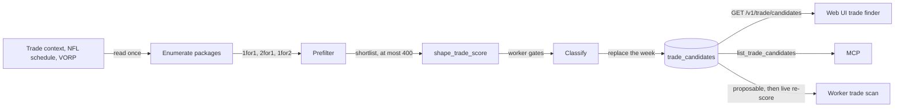

Trade candidates are a precomputed, deterministic list of the trades we could propose. A job enumerates every small package against every counterparty and scores the promising ones with the [trade scorer](trade-scoring.md). It classifies each package with the worker's [staging gates](outgoing-trades.md#which-generated-packages-qualify) and stores the run. The worker's trade scan and the web UI's trade finder both read from it. Neither has to guess packages anymore.

## How does a run work?

| Step | Rule |
| --- | --- |
| Entrypoint | `python -m src.jobs.trade_candidates` (`--league-id`, `--team-id`, `--season`, `--week`, `--horizon 4`, `--max-candidates 400`) |
| Week | `--week`, or the upcoming week from `resolve_upcoming_week`. Exit 1 if it can't be resolved; exit 0 without writing once the season is over. |
| Reads | `get_league_trade_context`, the NFL schedule for each horizon week, and as-of-week VORP for every rostered player. Each is read **once** per run. The context also carries the players committed to our pending offers. |
| Universe | For each counterparty, every 1-for-1, 2-for-1 and 1-for-2 package. A player is left out when he is in an IR slot, `OUT`/`INJURY_RESERVE`, has no internal id mapping, or has no position. Players in one of our unresolved outgoing offers (`committed_players` in the context) are also left out of what we send; the other team's players are not affected. |
| Shape | Named from our side: `2for1` means we send two players and receive one. |
| Scoring | `shape_trade_score` with the shared context, so each item matches `POST /v1/trade/score` for the same package at `computed_at`. |
| Storage | `trade_candidate_runs` (one row per league/season/week) and `trade_candidates` (one row per scored package). A run replaces its week in one transaction. |
| Audit | `run_log` row `trade_candidates`, whose summary holds the `enumerated`, `prefiltered`, `scored`, `excluded_committed`, `proposable`, `needs_drop`, `one_sided` and `duration_seconds` counts. |

## What does the prefilter keep?

Before any solve, each team's optimal lineup is computed once per horizon week. The prefilter then checks each package against those lineups. It never drops a package that full scoring would mark `proposable`; a brute-force test in `tests/test_trade_candidate_service.py` checks this. A **group** is a position plus every position that shares a FLEX slot with it.

| Side | Kept when |
| --- | --- |
| Us | In some week, a player we receive is at or above the weakest starter in his group. Our gain G > 0 is impossible otherwise. |
| Counterparty | In some week, a player they receive reaches their weakest starter in his group, **or** there is some week where the trade costs them no starter. That is, each starter they send has a bench or incoming player in his group at least as good. |

The counterparty check is looser than "both sides gain a starter", because the gate is I ≥ 0. A bench-for-bench swap that leaves their lineup unchanged passes it.

| Ordering and cap | Rule |
| --- | --- |
| Estimate | Per side and week: the incoming players' VORP above their group's weakest starter (floored at 0), minus the largest gap between a departing starter and his best bench or incoming replacement |
| Order | Packages that fit both roster limits first, then those whose counterparty estimate isn't negative, then our estimate and theirs (descending), then `candidate_key` |
| Spread | Counterparties are interleaved round-robin, each in that order, so every team keeps its best packages |
| Cap | The first 400 are scored. The rest are counted in `prefiltered` but not stored. |

The estimates only rank the shortlist; they never decide what the prefilter keeps.

## How is each package classified?

The reason codes are the worker's own `eligibilityReasons`, so a `proposable` candidate passes the worker's gates when it was computed.

| Reason | Fails when |
| --- | --- |
| `no_scored_weeks` | No horizon week could be scored |
| `no_gain_for_us` | Our raw lineup gain G is null or ≤ 0 |
| `hurts_counterparty` | Their raw lineup change I is null or < 0 |
| `exceeds_roster_limit` | Either roster ends up over its limit |
| `unmapped_traded_player` | A traded player has no internal id |

| `status` | Rule |
| --- | --- |
| `proposable` | No reasons |
| `needs_drop` | Only `exceeds_roster_limit`. The offer needs a drop it doesn't contain, typical of 2-for-1s against full rosters. |
| `one_sided` | Anything else |

## What does `GET /v1/trade/candidates` return?

| Parameter | Values |
| --- | --- |
| `league_id`, `season`, `week` | Required |
| `counterparty_team_id` | ESPN team id |
| `receive_position`, `send_position` | Any traded player on that side has this position |
| `shape` | `1for1`, `2for1`, `1for2` |
| `status` | `proposable` (default), `needs_drop`, `one_sided`, `all` |
| `sort` | `final_score` (default), `our_gain` (G), `their_benefit` (their lineup change I). Descending, nulls last, then `candidate_key`. |
| `limit`, `offset` | 1–200 (default 50); ≥ 0 |

| Field | Meaning |
| --- | --- |
| `computed_at`, `run_id`, `horizon` | Which run produced the list |
| `total` | Matching items before paging |
| `team_counts[]` | Per counterparty: `proposable`, `needs_drop` and `one_sided`, over the whole run, ignoring filters |
| `items[].counterparty` | `{team_id, name}` |
| `items[].receive`, `items[].send` | Players: `espn_id`, `player_id`, `name`, `position`, `nfl_team`, `vorp` (as-of-week), `nfl_bye_week` |
| `items[].final_score`, `our_lineup_gain`, `our_weighted_gain`, `counterparty_lineup_change`, `counterparty_weighted_benefit`, `our_schedule_adjustment` | Final score, G, G*, I and C* from the [trade score](trade-scoring.md#how-are-g-c-and-the-final-score-calculated), plus the schedule adjustment G* − G |
| `items[].scored_weeks`, `horizon_weeks`, `complete_horizon` | Horizon coverage |
| `items[].bye_coverage` | Each side's bye-crunch weeks, before and after |
| `items[].status`, `reasons`, `shape` | Classification above |
| `items[].candidate_key` | sha256 of league, season, both teams and the sorted ids on each side. The week is left out, so the key stays the same across runs. |

| Case | Response |
| --- | --- |
| Job never ran for that week | 404, naming the job |
| Run found nothing | 200 with empty `items` |
| Bad parameter | 422 |
| Other errors | Mapped like the other trade reads (503 when the trade context is unavailable) |

The MCP tool `list_trade_candidates` takes the same filters.

:::warning[Candidates are a snapshot]
Rosters change after `computed_at`. Re-score a candidate with `POST /v1/trade/score` before acting on it, and treat a list older than about 36 hours as stale. The worker scan and the UI both do this.
:::

## Related

- [Trade scoring](trade-scoring.md)
- [Outgoing trades](outgoing-trades.md)
- [Trade context](trade-context.md)
- Core: [trade_candidate_service.py](https://github.com/cvillarr23/fantasy-core-pipeline/blob/main/src/services/trade_candidate_service.py), [jobs/trade_candidates.py](https://github.com/cvillarr23/fantasy-core-pipeline/blob/main/src/jobs/trade_candidates.py)
