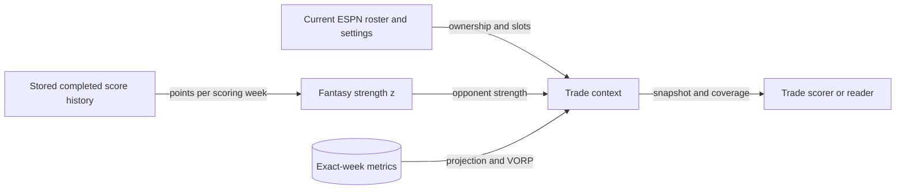

Trade context combines current ESPN ownership with completed fantasy scoring and upcoming matchups. Use it to inspect the roster and strength evidence behind a trade score.



## Which snapshot and horizon do you get?

| Request or evidence | Rule |
| --- | --- |
| REST | `GET /v1/trade/context` |
| MCP | `get_league_trade_context_model` |
| Inputs | Configured league, season, as-of week, horizon |
| Horizon | Default 4; range 1–18 |
| Inclusive end | `min(week + horizon − 1, regular_season_end_week)` |
| Metrics | Exact-week projections/VORP; explicit internal identity mapping |
| `roster_snapshot` | Fetch time, observed ESPN week, match with requested week |

:::warning[Ownership is current]
Historical or future as-of requests still use the current ESPN roster. They do not reconstruct ownership for the requested week.
:::

## How is fantasy strength calculated?

```text
points_per_week = sum(completed_matchup_points) / completed_scoring_weeks
strength_z = (points_per_week − league_mean) / population_standard_deviation
```

| History rule | Behavior |
| --- | --- |
| Eligible periods | Completed regular-season periods ending before both requested and observed ESPN week |
| Multiweek matchups | Divide totals by actual scoring-week count |
| Byes, ambiguous matches, incomplete totals | Exclude from observations |
| League mean/stddev | Use teams with observations; population standard deviation |
| At least two observations, zero stddev | Observed teams get z=0 |
| Fewer than two observations | Z scores remain null |
| Team without history | Null strength |

Positive z means stronger fantasy scoring. It describes completed points, not win probability or NFL defense strength.

## What are committed players?

`committed_players` lists our players (ESPN ids) who are in an outgoing offer that is `approved`, `submitting` or `submitted` and not yet resolved. ESPN still shows them on our roster, so recommenders and the worker's LLM fallback must not send them in another trade. Each entry has `espn_id` and the `offer_keys` holding him.

An offer stops counting when its [resolution is recorded](./outgoing-trades.md#how-is-an-offer-resolved) or after `OUTGOING_COMMIT_HOURS` (default 72) from its `executed_at`, whichever comes first. The list is read on every call, not from the 60-second cache.

## What does schedule coverage mean?

| Weekly status | Meaning |
| --- | --- |
| `scheduled` | Pairing known; strength may still be null |
| `bye` | Fantasy bye |
| `unavailable` | Pairing unavailable or ambiguous |

Schedule strength is the mean opponent z only when every non-bye week has known pairing and strength, with at least one strength observation. Missing opponents are not treated as average strength.

<details>
<summary>Output fields and read errors</summary>

| Output | Contents |
| --- | --- |
| Roster | Position, slot, ESPN injury status, eligible slots and identity mapping |
| Metrics | Per-week `projected_points` and `vorp_score` |
| History | Completed matchup/scoring-week counts and unavailable periods |
| Schedule | Week, matchup period, status and opponent strength |
| Coverage | Missing mappings/metrics remain null and counted |

| HTTP status | Cause |
| --- | --- |
| 422 | Invalid request |
| 503 | Context unavailable |
| 504 | ESPN timeout |
| 502 | Other ESPN read failure |

</details>

## Related

- [Trade scoring](trade-scoring.md)
- [Incoming score evidence](incoming-trades.md)
- Implementation: [trade_context_service.py](https://github.com/cvillarr23/fantasy-core-pipeline/blob/main/src/services/trade_context_service.py)
