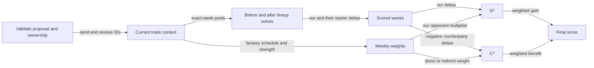

The trade score measures how an exchange changes optimal starters, weighted by fantasy opponents. Use it to compare G*, C* and coverage before reviewing an offer.



## What can you propose?

| Input or rule | Requirement |
| --- | --- |
| REST / MCP | `POST /v1/trade/score` / `score_trade_proposal` |
| Scope | League, season, week, horizon (default 4) |
| Teams | Our team and a different counterparty |
| Players | Nonempty send/receive ESPN IDs; no duplicates or overlap |
| Ownership | Each player belongs to its sending team in the current snapshot; failure is 409 |

For each horizon week, the scorer exchanges players and solves each team's starters before and after. Bench and IR have no standalone value; the scorer uses exact-week VORP without the lineup-only defense multiplier.

## How are G*, C* and the final score calculated?

Signs are from our perspective. `ΔL` is after minus before optimal starter VORP for one week.

```text
G = Σ ΔL_us,w
I = Σ ΔL_them,w
m(z) = 1 + 0.25 × clamp(z, −2, 2)
G* = Σ ΔL_us,w × m(our fantasy opponent's z)
C* = Σ −ΔL_them,w × counterparty_weight_w
final_score = G* + C*
our_schedule_adjustment = G* − G
```

| Weight | Rule |
| --- | --- |
| Opponent multiplier `m` | Range 0.5–1.5 |
| Teams face each other | Counterparty weight equals our opponent multiplier |
| Other matchup | Counterparty weight is `0.25 × m(their opponent's z)` |
| Fantasy bye | Weight 0 |
| Unknown pairing/strength | Weight unavailable, not 1 |

| Example: our gain +4 against z=1; their gain +2 | G* | C* | Final |
| --- | --- | --- | --- |
| They face another z=0 team | 5 | −0.5 | 4.5 |
| We face each other; their z=1 | 5 | −2.5 | 2.5 |

:::note[Scoring does not authorize a trade]
There is no built-in acceptance threshold here. Human approval and worker gates apply separately; the [shadow policy](incoming-trades.md#shadow-policy) only records hypothetical verdicts.
:::

## When is a week unscored?

| Condition | Treatment |
| --- | --- |
| Traded player unmapped or unknown position | Unscored week |
| Traded player lacks required exact-week metrics | Unscored week |
| Neither team has usable week metrics | Unscored week |
| Unsupported starter slot or unfillable lineup | Unscored week |
| Traded player's confirmed NFL bye | Legitimate exclusion |
| As-of-week ESPN `OUT`, `INJURY_RESERVE` or IR slot | Legitimate exclusion; future weeks do not assume the status persists |
| Missing metrics and unreadable NFL schedule | Cannot confirm a bye |
| Missing untraded-player metrics/mapping/position | Omit player; record `partial_roster_weeks` if the week still scores |
| Unfillable K/D-ST on either side | Hold slot on both sides to avoid artificial gains |

## How should you read incomplete scores?

| Output | Meaning |
| --- | --- |
| Raw G/I | Sum scored weeks; null if none score |
| G* or C* | Null if any required weight in scored weeks is unknown |
| `final_score` | Requires both weighted terms; null for empty or entirely fantasy-bye-weighted scored horizon |
| `complete_horizon` | No unscored horizon weeks; does not certify full roster coverage or known strength |
| `unscored_weeks[].reasons` | Why weeks were withheld |
| `final_score_unavailable_reasons` | Why weighted terms/final score were withheld |

:::warning[Partial means partial]
No prior-week metric fills a gap. A numeric partial-horizon score is not a full-horizon estimate.
:::

<details>
<summary>Roster impact and raw player totals</summary>

| Evidence | Contents |
| --- | --- |
| `roster_impact` | Before/after starter lists, totals, deltas, held slots, exclusions and non-IR roster sizes |
| Roster limit | Sum configured non-IR slots |
| Unequal trade | Report `exceeds_roster_limit`; do not simulate drops or suppress the numeric score |
| `raw_vorp` | Single-week mapped incoming minus outgoing VORP, missing internal IDs and unmapped ESPN IDs |

Raw player totals are separate evidence; they do not calculate G* or rank the incoming inbox.

</details>

## Related

- [Context and strength](trade-context.md)
- [Outgoing evaluation](outgoing-trades.md)
- [Incoming review](incoming-trades.md)
- Implementation: [trade_score_service.py](https://github.com/cvillarr23/fantasy-core-pipeline/blob/main/src/services/trade_score_service.py)
