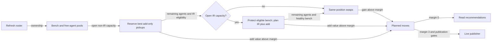
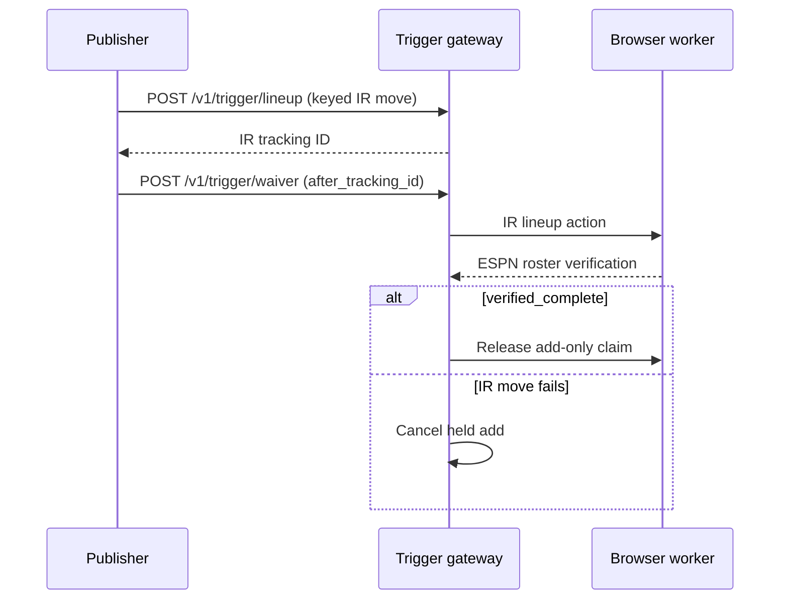

Waivers fill open non-IR roster slots, replace a weak bench player, or use an IR stash to make room for an add. Use this page to distinguish a displayed recommendation from a live claim.



## When can we just add a player?

`open_roster_slots` is the configured sum of all non-IR lineup slots (starters and bench) minus this team's non-IR `league_rosters` occupancy, clamped at zero. Missing league settings mean zero capacity.

The planner reserves up to that many free agents by descending VORP before considering swaps or IR chains. It uses all projected free agents, so multiple pickups can share a position. A reserved player cannot also appear in a swap or IR chain. Remaining agents can still improve the bench.

These moves have `kind: "add"`, an internal `drop_player_id: null`, and null `bench_player` and `ir_player` summaries. Their gain is the add's full VORP. The read path requires VORP >0 and supports the same prior-week averages and bye exclusions as swaps; live claims require VORP >3. Add-only claims publish before swaps, without an IR move, dependency tracking ID, or IR publication flag.

## Which player gets dropped?

| Input | Selection |
| --- | --- |
| Bench | Non-starters outside IR |
| Free agents | Unrostered league-wide; best VORP at each position |
| Drop candidate | Worst bench VORP at the add's position |
| Metric key | Exact season/week; null VORP on an existing row becomes 0 |

```text
swap_gain = add_vorp − drop_vorp
live ordinary swap qualifies when swap_gain > 3.0
```

:::tip[The threshold is strict]
Bench VORP 2 and free-agent VORP 6 produce a qualifying gain of 4. A gain of exactly 3 does not qualify.
:::

Starters and IR occupants are never ordinary drop candidates. The planner has no FAAB model, cross-position ordinary drop search or explicit equal-value tie-break.

## When does IR make room for an add?

| Rule | Behavior |
| --- | --- |
| Eligibility | ESPN `OUT` or `INJURY_RESERVE`, case-insensitive |
| Capacity | `max(0, configured_IR_slots − occupied_IR_slots)`; missing settings mean 0 |
| Protection with open capacity | Protect every IR-eligible bench player from dropping |
| Stash selection | Descending VORP; at most the open capacity |
| Add selection | Descending best-per-position agents from any position; own VORP exceeds margin |
| Gain | Add's whole VORP because nobody leaves |
| Remaining swaps | Healthy bench against agents at positions not used for IR + add |
| Eligible players beyond capacity | Remain protected in this pass; ordinary drops resume once IR is full |

Standalone stash hints can overlap an IR + add suggestion. Choose one action plan rather than executing both suggestions independently.

## Why do recommendations differ from live claims?

| Path | Metrics | Strict margin | Output |
| --- | --- | --- | --- |
| `waiver_service` | Exact week when both pools exist; otherwise prior three same-season weeks | >0 | Recommendations and `ir_moves`; no publication |
| `waiver_evaluator` | Exact-week pools required | >3 | Live claims and gated IR + add |

Both refresh stale roster ownership before planning. Add-only recommendations come first; within each group, recommendations sort by `vorp_delta` and expose the kind, position, add, bench/IR player and source weeks; rumor fields are currently null.

<details>
<summary>Read fallback and unavailable inputs</summary>

| Condition | Result |
| --- | --- |
| Exact-week read pool missing | Average available per-player VORP over prior three same-season weeks |
| Newest usable fallback week older than immediately prior week | Raise unavailable-input error |
| Target-week NFL bye | Exclude player using the schedule |
| Week 1 lacks data | Do not borrow the previous season |
| Missing free-agent pool, missing bench with no open roster slots, or schedule failure | Raise unavailable-input error |
| Live free-agent pool missing, or bench missing with no open roster slots | Fail; no prior-week fallback |
| Successful empty plan | No qualifying improvement |

</details>

## How is IR + add published?



| Gate | Behavior |
| --- | --- |
| `AUTO_PUBLISH_IR_MOVES` unset/off | Log IR + add suggestions; ordinary swaps still publish |
| Flag `1`, `true` or `yes` | Enable, trimmed and case-insensitive |
| Ineligible/unknown-status IR occupant | Block unattended IR + add |
| Missing season/week or IR tracking ID | Prevent the add |
| Saved rumor action | Recheck the flag at delivery |
| Missing ESPN mapping | Skip the ordinary move |

<details>
<summary>Claim identity and evidence</summary>

`POST /v1/trigger/waiver` carries decision evidence. Its key includes team, season/week, add/drop identities and IR identity when chained; it excludes VORP and Job name so another run in the same waiver week cannot duplicate a claim.

A duplicate receipt confirms an earlier publication. Worker execution and ESPN verification determine completion.

</details>

## Related

- [Lineup and IR slots](lineup-optimization.md)
- [Rumor-triggered claims](rumor-actions.md)
- Implementation: [waiver_evaluator.py](https://github.com/cvillarr23/fantasy-core-pipeline/blob/main/src/optimization/waiver_evaluator.py), [waiver_service.py](https://github.com/cvillarr23/fantasy-core-pipeline/blob/main/src/services/waiver_service.py), [waiver_strategy.py](https://github.com/cvillarr23/fantasy-core-pipeline/blob/main/src/backtesting/waiver_strategy.py)
