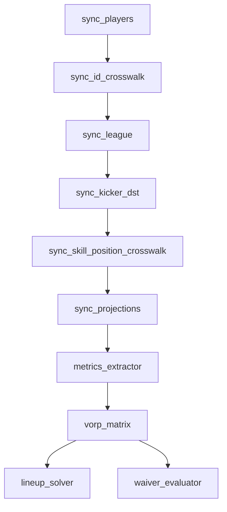

Ingestors pull player, league, projection and score data into Postgres. VORP and the optimizers read it. Run order matters, because each step depends on columns the previous one fills.

:::note[Schedules live in fantasy-infra]
The times below come from the CronJob manifests in `fantasy-infra` (`base/core-pipeline/`) as of 2026-10-09. All use the `America/Chicago` time zone. If a time here disagrees with the manifest, the manifest wins.
:::

## In what order do they run?

| Dependency | Why |
|---|---|
| `sync_id_crosswalk` after `sync_players` | It updates existing player rows. |
| `sync_league` after `sync_id_crosswalk` | Roster rows are matched on `players.espn_id`. |
| `metrics_extractor` after `sync_id_crosswalk` | It needs a fresh `gsis_id`. |
| `sync_kicker_dst` after `sync_league` | It reuses the ESPN connection and needs the K and D/ST rows from `sync_players`. |
| `sync_espn_ownership` after `sync_id_crosswalk` | It maps ESPN ids to players through `players.espn_id`. |
| `vorp_matrix` after projections and metrics | VORP is computed from `projected_points` and the usage metrics. |
| `lineup_solver` after `vorp_matrix` | Its objective is each player's `weekly_stats.vorp_score`. |

## What does each ingestor do?

| Module | Source | Writes | Notes |
|---|---|---|---|
| `sync_players` | Sleeper player master | `players` | Retags Sleeper's `DEF` as `D/ST`. Gated to once a day by a Redis lock; pass `--force` to override. It also [publishes injury alerts](./queue-publishing.md#direct-publisher-injury-alerts). |
| `sync_id_crosswalk` | DynastyProcess crosswalk | `players.espn_id`, `players.gsis_id` | Covers most skill players, and no K or D/ST. |
| `sync_league` | ESPN league API | `league_settings`, `league_teams`, `league_rosters` | Needs `ESPN_LEAGUE_ID`, `ESPN_S2`, `ESPN_SWID`. `--season` is required. |
| `sync_kicker_dst` | ESPN `kona_player_info` | `players.espn_id`, `weekly_stats.projected_points` for K and D/ST | Takes `--season` and `--week`. A matched player with no projection gets no row, never a 0.0 row. |
| `sync_skill_position_crosswalk` | ESPN `kona_player_info`, no ownership filter | `players.espn_id` | Fills the QB, RB, WR and TE players the crosswalk missed. Matches by name and team. |
| `sync_espn_ownership` | ESPN `kona_player_info`, sorted by percent owned | `espn_player_ownership` | Percent owned, percent started, 24h change and positional rank for about the 1000 most-owned players. ESPN's `-1` and missing fields are stored as NULL. Takes optional `--season` and `--week`, defaulting to the current season and upcoming week. A rerun in the same week upserts that week's row. |
| `sync_projections` | Sleeper projections | `weekly_stats.projected_points` | QB, RB, WR and TE only. Takes `--season` and `--week`. |
| `metrics_extractor` | nflverse play-by-play, snaps, schedule | `weekly_stats` usage and betting columns | Defaults to the last completed week. See below. |
| `vorp_matrix` | `weekly_stats`, `league_settings` | `weekly_stats` VORP columns | Takes `--season` and `--week`. |
| `sync_defense_strength` | nflverse, previous season | `defense_position_strength` | Only needed when `MATCHUP_WEIGHTING_ENABLED=true`. |
| `sync_rumors` | RotoWire RSS, r/fantasyfootball, ESPN news, Bluesky | `raw_signals` | Fetch and store only. The LLM interpretation happens in the worker. See [News sources](#which-news-sources-does-sync_rumors-read). |
| `sync_actual_scores` | ESPN scoring weeks | `fantasy_*` tables, `weekly_stats.actual_points` | See [Score history](#how-is-score-history-stored). |
| `live_games` | ESPN's public NFL scoreboard and game summaries, plus the league's live matchup payload | Redis `live:*` keys only | A launcher service job during game windows. See [Live game state](#how-does-live_games-keep-live-game-state). |

## Which news sources does `sync_rumors` read?

| `source` | Where | Matching | Rumor digest |
|---|---|---|---|
| `rotowire_rss` | RotoWire's NFL news RSS | Fuzzy, by name | Yes |
| `reddit_fantasyfootball` | r/fantasyfootball, through Reddit OAuth (`REDDIT_CLIENT_ID`, `REDDIT_CLIENT_SECRET`, `REDDIT_USER_AGENT`) | Fuzzy, by name | Yes |
| `espn_news` | ESPN's NFL news feed, 50 articles. A player on our roster or this week's opponent's roster with no article about him in that feed also gets a call to his ESPN athlete page. | Exact, by the article's athlete tags through `players.espn_id`. One row per tagged athlete. | No |
| `bluesky` | Each handle in `NEWS_BLUESKY_HANDLES` (comma-separated), read from the public AppView with no auth. Reposts and replies are skipped. | Fuzzy, by name | No |

`espn_news` and `bluesky` rows are display-only, for the player news feed. The worker's rumor digest reads only the sources in `AUTOMATION_SOURCES` (fantasy-browser-worker's `src/db/rumor_signals.js`), so these two never drive a waiver or lineup move. Adding a source to automation means changing that list.

Each source fails on its own: an outage logs and leaves that source empty for the run. The roster lookup needs `ESPN_TEAM_ID`, and the opponent lookup also needs `ESPN_LEAGUE_ID` and a `fantasy_matchups` row for the upcoming week. Without them, the per-athlete calls narrow to our roster or stop, and the general feed still runs. `rumor-syncer` runs inline in the launcher, so these variables come from the launcher Deployment's env. An empty `NEWS_BLUESKY_HANDLES` skips Bluesky.

An article tagging more than `ESPN_COVERAGE_MAX_ATHLETES` (3) athletes, such as a recap or weekly roundup, still gets a row per athlete. It doesn't count as news about them, though, so it doesn't stand in for the athlete-page call.

## How does `live_games` keep live game state?

`python -m src.ingestion.live_games [--season N] [--week N] [--once]` polls this week's fantasy matchup for one game window and keeps a snapshot in Redis. The live API reads that snapshot, so no request ever waits on ESPN. It runs as the `live-games` launcher service job (fantasy-infra), one run per game window.

The launcher starts it from nflverse kickoff times through the job's catalog `kickoffs` block, not cron slots: `lead` (20m in production) before each distinct regular-season kickoff, on any weekday. Kickoffs are reread hourly, so a flexed or moved game is picked up. A failed reread keeps the last good copy. With no readable schedule at all, or on the day of a game whose time isn't set yet, it starts every `fallback_every` (30m) instead. A start that finds the previous run still up is skipped, since that run already covers the new kickoff.

At startup it resolves the upcoming week (`resolve_upcoming_week`), reads our matchup period and opponent from `fantasy_matchups` (`ESPN_LEAGUE_ID`, `ESPN_TEAM_ID`), and loads `players.espn_id`. It exits 0 when the season is over or we have no scheduled matchup, and 1 when the week can't be resolved.

Each tick:

1. Reads the week's scoreboard from ESPN's public site API, with no auth.
2. Reads the league's `mMatchupScore` payload for our matchup period, once. This is the same request `sync_actual_scores` makes, with `ESPN_S2` and `ESPN_SWID`. Both rosters come from it, bench included.
3. Tracks every game with a team that has a player on either roster.
4. Fetches `summary?event=` for each tracked game in progress, plus once more when a game turns final, to get its plays.
5. Writes the keys below in one pipeline.

A failed fetch is retried 3 times. A failed tick logs and the loop carries on.

| Key | Value | TTL |
|---|---|---|
| `live:game:{event_id}` | `{event_id, status: not_started\|in_progress\|final, detail, period, clock, home: {abbr, score}, away: {abbr, score}, possession, yard_line, red_zone, kickoff, updated_at}`. `period`, `clock`, `possession` and `yard_line` are null unless the game is live. Scores are null before kickoff. | 6h |
| `live:player:{player_id}` | `{event_id, team, fantasy_team_id, lineup_slot_id, position, stat_line, live_points, applied_stats, applied_qty, updated_at}`, for every player on either matchup roster with a `players.espn_id` match. | 6h |
| `live:plays:{event_id}` | A list, newest first, capped at 300: `{play_id, period, clock, text, player_ids, scoring, recorded_at, fantasy_delta}`. Only plays that involve a matchup player are kept. `recorded_at` is the tick that first saw the play (ESPN gives no wall time) and `fantasy_delta` maps each `player_id` to the change in that player's `live_points` since the previous tick. Both are carried forward unchanged on later ticks. | 6h |
| `live:player_ids` | A JSON list of the `player_id`s written to `live:player` this tick, sorted. The feed reads players through it instead of scanning keys. | 6h |
| `live:updated_at` | ISO-8601 time of the last successful tick. | 6h |
| `live:health` | `{updated_at, last_success_at, season, week, tracked_events}`, written every tick, including a failed one. This is the service job's launcher `health` key. The live API serves nothing without it, and needs `season` and `week` to match for the matchup overlay and feed. Health without `season` (from a poller older than that key) counts as not live. | 10 min |
| `live:last_viewed` | Written by the live API, not by this job: the unix epoch seconds when someone last opened a live page. ISO-8601 is also accepted. | n/a |

Team codes are nflverse codes (`WAS`, not ESPN's `WSH`), the same as `players.team`.

**Points are ESPN's own.** `live_points` is the actual stat row's `appliedTotal` (`statSourceId` 0), which ESPN updates in game and which matches the matchup score. `applied_stats` is that row's points per ESPN stat id. `stat_line` is its raw counts, named: `passYd`, `passTD`, `int`, `rushYd`, `rushTD`, `rec`, `recYd`, `recTD`, `fumLost` and `twoPt`, plus kicker and D/ST stats. A stat ESPN didn't report is left out. A player who hasn't played yet has `live_points: null`, never 0.

**Scoring breakdown.** `applied_qty` is the raw count behind each `applied_stats` entry (98 for 98 rushing yards), and `position` is ESPN's default position, which picks the league's per-position rules (every D/ST stat is a `pointsOverrides["16"]` rule). The live API turns these into `breakdown` lines (`src/espn_scoring.py`) at read time, labelled from `league_settings.scoring_settings`: `points` is always ESPN's own `applied_stats` value, so the lines add up to `live_points`. An unknown stat id is left out and logged, and anything that doesn't add up shows as an `other` line. `GET /v1/scoring/rules` lists the same rules in plain English, and `GET /v1/matchup/games/{event_id}` splits one game's points by side, counting starters only.

**Plays are matched by name.** ESPN's plays carry no athlete ids. A player is tagged when the play text has his play-by-play name (`J.Gibbs`, `Ja.Chase`, `A.St. Brown`) or his full name (scoring plays), without a Jr./III suffix. A tag only counts when the player's team is one of the play's teams. A D/ST is tagged on turnovers, sacks, safeties and scores while its team is on defense (a score against it counts toward points allowed), and on its own return touchdowns. Two teammates with the same initial and last name would both be tagged.

**Play deltas.** A play's `fantasy_delta` for a player is null when the player has more than one new play in the same tick (the change can't be split between them), when the player had no earlier `live:player` row (the first tick, or after the keys expired), or when ESPN has no points for him. It is also null for a game's new plays on the tick after one that couldn't refresh that game's plays (its summary or its stored plays couldn't be read): `live:player` moved on that tick, so the baseline already includes those plays' points. The baseline is read back from Redis before each write, so a restart doesn't lose it. Because ESPN can post a stat a tick after the play, a delta can land on the next play instead.

**Cadence.** Ticks run every 30s while `live:last_viewed` is under 5 minutes old, and every 180s otherwise. The wait rechecks `live:last_viewed` every 10s, so a new viewer speeds polling up at once. A summary that is unavailable leaves that game on its scoreboard state and keeps its previous plays. So does a failed read of the stored plays: the list is left as it is for that tick rather than rewritten with every play looking new.

**Exit.** The poller exits 0 once no tracked game is in progress and none kicks off within 30 minutes. That covers every game being final, and an empty window costing one tick. SIGTERM also stops it cleanly.

## When do they run?

| CronJob | Schedule | Runs |
|---|---|---|
| `fantasy-rapid-status-syncer` | Every 10 min, Thursday, Sunday, Monday | `sync_players` |
| `fantasy-weekly-ingestor` | Tuesday 16:00 | `sync_league`, then `metrics_extractor` |
| `fantasy-sync-actual-scores` | Tuesday 17:05 | `sync_actual_scores` |
| `fantasy-sync-actual-scores-reconcile` | Friday 10:00 | `sync_actual_scores` again, to pick up stat corrections |
| `fantasy-draft-prep-refresher` | Daily 18:00 | For the upcoming week and up to three more: `sync_projections`, `sync_kicker_dst`, `vorp_matrix`. Under the launcher, `projections-refresh` fans out one child per week (`--week-offset 0..3`), and the children run in parallel within the pod cap |
| `fantasy-lineup-optimizer` | Tuesday 19:15 | `lineup_solver` |
| `fantasy-weekly-waiver-trigger` | Tuesday 20:30 | `waiver_evaluator` |
| `fantasy-rumor-syncer` | Every 30 min | `sync_rumors` |
| `fantasy-rumor-action-trigger` | Daily 21:45, plus `rumor.signal_created` once the catalog subscribes it | `rumor_action_service` |

:::warning[Not scheduled]
No CronJob runs `sync_id_crosswalk`, `sync_skill_position_crosswalk` or `sync_defense_strength`. Run them by hand after a large `sync_players` change, in the order shown above.
:::

## How does `metrics_extractor` pick a week?

By default it processes the last **completed** regular-season week: every game final in the nflverse schedule. nflreadpy's own "current week" is already the upcoming week by Tuesday, so it isn't used.

| Situation | Result |
|---|---|
| Preseason, no completed week | Exit 0, nothing written. |
| Resolved week writes 0 rows | Exit 1. |
| Play-by-play is missing a game the schedule marks final | `IncompletePlayByPlayError`, exit 1, and the missing games are named. Nothing partial is written. |
| A rerun after nflverse catches up | Fills the week. The upsert is idempotent. |

## How is the target week chosen elsewhere?

`src/nfl_schedule.py` returns the earliest regular-season week with a game not yet final, retrying the schedule download before it raises `WeekResolutionError`. It never substitutes another week. When the regular season is over, the optimizer CLIs exit 0 as a no-op.

## How is score history stored?

`sync_actual_scores` reprocesses every completed week on each run, so a later run recovers a missed week and picks up ESPN stat corrections. A week ESPN hasn't finished fails the Job rather than being skipped or guessed; weeks before it stay committed.

| Table | Grain | Key |
|---|---|---|
| `fantasy_matchups` | Team and matchup period | `(league_id, season, matchup_period, team_id)` |
| `fantasy_team_week_scores` | Team and week | `(league_id, season, week, team_id)` |
| `fantasy_player_week_scores` | Player, team and week | `(league_id, season, week, team_id, espn_id)` |

Each player's payload keeps ESPN's `applied_stats` (points per stat id) and `applied_qty` (the count behind each) from the actual stat row, the same fields the live poller writes. `GET /v1/matchup` turns them into a completed week's `breakdown` lines at read time. Because every run rewrites every completed week, weeks stored before these fields were kept gain them on the next run.

It also sets `weekly_stats.actual_points`, with `actual_points_source` and `actual_points_updated_at` recording where each value came from. Use `--dry-run` to validate a week without opening the database.

## Related

- [Data model](./data-model.md): the tables these jobs write.
- [Queue publishing](./queue-publishing.md): what the optimizers send downstream.
