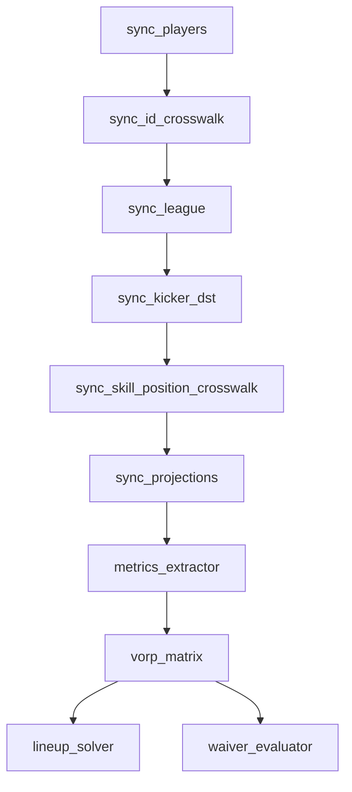

Ingestors pull player, league, projection and score data into Postgres. VORP and the optimizers read it. Run order matters, because each step depends on columns the previous one fills.

:::note[Schedules live in fantasy-infra]
The times below come from the CronJob manifests in `fantasy-infra` (`base/core-pipeline/`) as of 2026-10-09. All use the `America/Chicago` time zone. If a time here disagrees with the manifest, the manifest wins.
:::

## In what order do they run?

| Dependency | Why |
|---|---|
| `sync_id_crosswalk` after `sync_players` | It updates existing player rows. |
| `sync_league` after `sync_id_crosswalk` | Roster rows are matched on `players.espn_id`. |
| `metrics_extractor` after `sync_id_crosswalk` | It needs a fresh `gsis_id`. |
| `sync_kicker_dst` after `sync_league` | It reuses the ESPN connection and needs the K and D/ST rows from `sync_players`. |
| `vorp_matrix` after projections and metrics | VORP is computed from `projected_points` and the usage metrics. |
| `lineup_solver` after `vorp_matrix` | Its objective is each player's `weekly_stats.vorp_score`. |

## What does each ingestor do?

| Module | Source | Writes | Notes |
|---|---|---|---|
| `sync_players` | Sleeper player master | `players` | Retags Sleeper's `DEF` as `D/ST`. Gated to once a day by a Redis lock; pass `--force` to override. It also [publishes injury alerts](./queue-publishing.md#direct-publisher-injury-alerts). |
| `sync_id_crosswalk` | DynastyProcess crosswalk | `players.espn_id`, `players.gsis_id` | Covers most skill players, and no K or D/ST. |
| `sync_league` | ESPN league API | `league_settings`, `league_teams`, `league_rosters` | Needs `ESPN_LEAGUE_ID`, `ESPN_S2`, `ESPN_SWID`. `--season` is required. |
| `sync_kicker_dst` | ESPN `kona_player_info` | `players.espn_id`, `weekly_stats.projected_points` for K and D/ST | Takes `--season` and `--week`. A matched player with no projection gets no row, never a 0.0 row. |
| `sync_skill_position_crosswalk` | ESPN `kona_player_info`, no ownership filter | `players.espn_id` | Fills the QB, RB, WR and TE players the crosswalk missed. Matches by name and team. |
| `sync_projections` | Sleeper projections | `weekly_stats.projected_points` | QB, RB, WR and TE only. Takes `--season` and `--week`. |
| `metrics_extractor` | nflverse play-by-play, snaps, schedule | `weekly_stats` usage and betting columns | Defaults to the last completed week. See below. |
| `vorp_matrix` | `weekly_stats`, `league_settings` | `weekly_stats` VORP columns | Takes `--season` and `--week`. |
| `sync_defense_strength` | nflverse, previous season | `defense_position_strength` | Only needed when `MATCHUP_WEIGHTING_ENABLED=true`. |
| `sync_rumors` | RotoWire RSS, r/fantasyfootball | `raw_signals` | Fetch and store only. The LLM interpretation happens in the worker. |
| `sync_actual_scores` | ESPN scoring weeks | `fantasy_*` tables, `weekly_stats.actual_points` | See [Score history](#how-is-score-history-stored). |

## When do they run?

| CronJob | Schedule | Runs |
|---|---|---|
| `fantasy-rapid-status-syncer` | Every 10 min, Thursday, Sunday, Monday | `sync_players` |
| `fantasy-weekly-ingestor` | Tuesday 16:00 | `sync_league`, then `metrics_extractor` |
| `fantasy-sync-actual-scores` | Tuesday 17:05 | `sync_actual_scores` |
| `fantasy-sync-actual-scores-reconcile` | Friday 10:00 | `sync_actual_scores` again, to pick up stat corrections |
| `fantasy-draft-prep-refresher` | Daily 18:00 | For the upcoming week and up to three more: `sync_projections`, `sync_kicker_dst`, `vorp_matrix` |
| `fantasy-lineup-optimizer` | Tuesday 19:15 | `lineup_solver` |
| `fantasy-weekly-waiver-trigger` | Tuesday 20:30 | `waiver_evaluator` |
| `fantasy-rumor-syncer` | Every 30 min | `sync_rumors` |
| `fantasy-rumor-action-trigger` | Daily 21:45 | `rumor_action_service` |

:::warning[Not scheduled]
No CronJob runs `sync_id_crosswalk`, `sync_skill_position_crosswalk` or `sync_defense_strength`. Run them by hand after a large `sync_players` change, in the order shown above.
:::

## How does `metrics_extractor` pick a week?

By default it processes the last **completed** regular-season week: every game final in the nflverse schedule. nflreadpy's own "current week" is already the upcoming week by Tuesday, so it isn't used.

| Situation | Result |
|---|---|
| Preseason, no completed week | Exit 0, nothing written. |
| Resolved week writes 0 rows | Exit 1. |
| Play-by-play is missing a game the schedule marks final | `IncompletePlayByPlayError`, exit 1, and the missing games are named. Nothing partial is written. |
| A rerun after nflverse catches up | Fills the week. The upsert is idempotent. |

## How is the target week chosen elsewhere?

`src/nfl_schedule.py` returns the earliest regular-season week with a game not yet final, retrying the schedule download before it raises `WeekResolutionError`. It never substitutes another week. When the regular season is over, the optimizer CLIs exit 0 as a no-op.

## How is score history stored?

`sync_actual_scores` reprocesses every completed week on each run, so a later run recovers a missed week and picks up ESPN stat corrections. A week ESPN hasn't finished fails the Job rather than being skipped or guessed; weeks before it stay committed.

| Table | Grain | Key |
|---|---|---|
| `fantasy_matchups` | Team and matchup period | `(league_id, season, matchup_period, team_id)` |
| `fantasy_team_week_scores` | Team and week | `(league_id, season, week, team_id)` |
| `fantasy_player_week_scores` | Player, team and week | `(league_id, season, week, team_id, espn_id)` |

It also sets `weekly_stats.actual_points`, with `actual_points_source` and `actual_points_updated_at` recording where each value came from. Use `--dry-run` to validate a week without opening the database.

## Related

- [Data model](./data-model.md): the tables these jobs write.
- [Queue publishing](./queue-publishing.md): what the optimizers send downstream.
