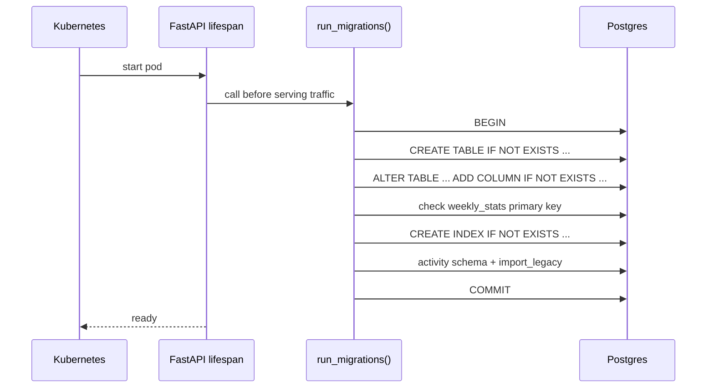

There is no migration tool and no version table. `run_migrations()` in `src/migrations.py` re-runs idempotent DDL every time the API starts. Read this page before you change `src/models.py`.

## What happens at startup?

| Property | Behavior |
|---|---|
| Trigger | The API's `lifespan` calls it on every pod start. CronJobs and other processes never run it. |
| Transaction | One transaction. If any statement fails, everything rolls back and the pod crashes. |
| Order | Fixed in `run_migrations()`: `players`, `weekly_stats`, league tables, `execution_log`, draft tables, signals and ledgers, indices, then the `activity_*` schema. |
| Idempotence | Every statement is safe to run again. There is nothing to record or skip. |
| Manual run | `python -m src.migrations`, with the database environment variables set. |

:::warning[The weekly_stats key can block startup]
`MIGRATE_WEEKLY_STATS_PK_ADD_SEASON` re-keys `weekly_stats` on `(player_id, season, week)`. If old rows have a NULL `season`, it skips with a NOTICE, and `run_migrations()` then raises a `RuntimeError` so the API fails loudly. Backfill `season` by hand, review it, and restart.
:::

## How do I add a table or column?

1. In `src/models.py`, add a constant.
   - A new table: `CREATE_<NAME>_TABLE` with `CREATE TABLE IF NOT EXISTS`.
   - A new column on an existing table: `ADD_<TABLE>_<COLUMN>_COLUMN` with `ALTER TABLE ... ADD COLUMN IF NOT EXISTS`.
   - Do not edit the original `CREATE TABLE` only. Existing clusters never re-run it, so the column wouldn't appear.
2. Import the constant in `src/migrations.py` and call `cursor.execute(...)` for it. Put it after the statement that creates its table and before `CREATE_INDICES`.
3. Add an index to `CREATE_INDICES` if a query filters on the new column.
4. Add a case to `tests/test_migrations.py` that asserts your statement runs, and in the right order.
5. Update the [Data model](./data-model.md) page in the same PR.
6. Roll out the API image first, then deploy any CronJob or worker image that reads the new column.

:::tip[Why the API first]
The CronJobs don't migrate. A CronJob image that reads a column before the API has restarted fails with an undefined-column error. The same holds for the browser worker, which writes `execution_log` directly.
:::

## What makes a change safe?

| Do | Don't |
|---|---|
| Add columns as nullable with no default when "not computed yet" must differ from zero. | Add `NOT NULL` without a default to a table with rows. |
| Give a new `NOT NULL` column a `DEFAULT` so existing rows backfill. | Rely on a one-off script to fill it. |
| Use `IF NOT EXISTS` on every `CREATE` and `ADD COLUMN`. | Use bare `CREATE TABLE` or `ADD COLUMN`. |
| Keep each change additive, so the old API image still works during a rollout. | Drop or rename a column the running image reads. |
| Use `ON DELETE SET NULL` for history that must outlive a player row; use `CASCADE` for rows meaningless without one. | Add a foreign key on a column that mixes id namespaces, such as `bot_decisions.target_player_id`. |
| Wrap a conditional change in a `DO $$ ... $$` block, as the primary-key migration does. | Assume a destructive step ran on every cluster. |

:::note
Dropping or renaming something is a multi-step change: stop reading it, deploy, then remove it by hand with a reviewed SQL statement. `run_migrations()` has no mechanism for destructive changes, and it shouldn't.
:::

## Where is the SQL?

| Location | Holds |
|---|---|
| `src/models.py` | DDL constants for every table except `activity_*`. Comments on each constant explain the design. |
| `src/services/activity_service.py` | The `SCHEMA` string for `activity_actions`, `activity_events`, `activity_outbox`, `activity_sessions` and `activity_reads`. |
| `src/migrations.py` | The execution order. |

## Related

- [Data model](./data-model.md)
- [Read-only access](./read-only-access.md): a default privilege makes new tables readable automatically.
