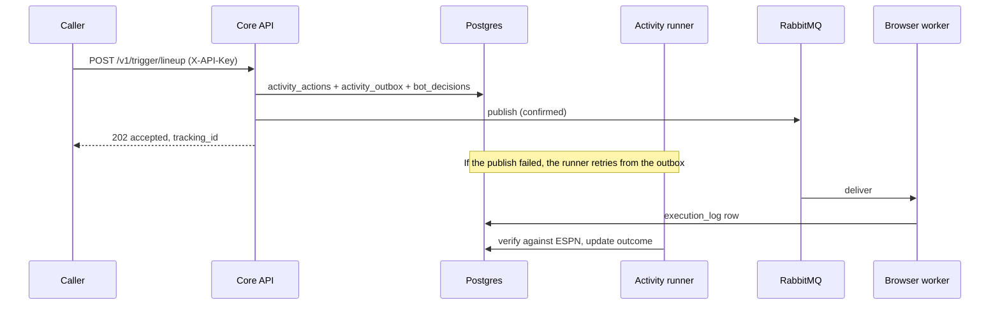
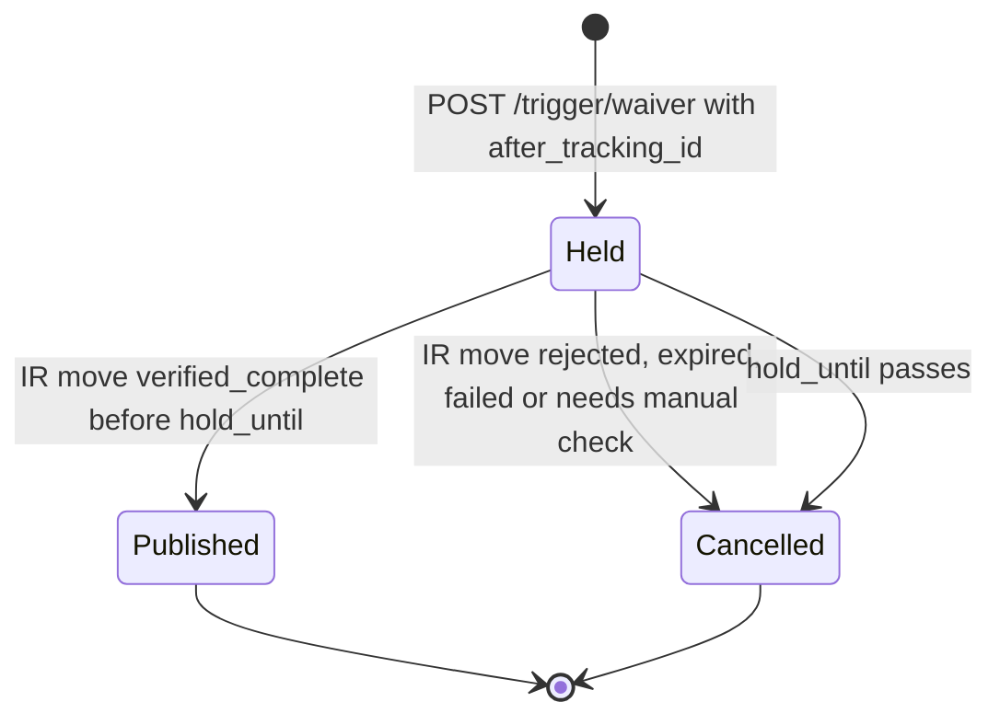

Core publishes to seven RabbitMQ queues. Six are consumed by `fantasy-browser-worker`: the API sends all six, and `sync_players` also publishes straight to `waiver_actions`. The seventh, `job_runs`, carries run commands to core's own job launcher. Every message is durable JSON on the default exchange, with the queue name as the routing key.

:::tip[Accepted is not done]
A `202` or `queued` status means the message left core, not that ESPN changed. The worker confirms results into `execution_log`, and the activity runner verifies them. See [Activity submissions](./activity-api.md).
:::

## How does a message get from a request to the worker?



Trigger queues go through the **outbox**. The API saves the action and the message in one transaction, publishes immediately, and leaves retries to the activity runner. A saved message is never lost if the broker is down.

The trade queues skip the outbox. They claim the offer in `execution_log` first, then publish, and reconcile by hand if the result is uncertain.

## What queues are there?

| Queue | Path | Source | Idempotency key |
|---|---|---|---|
| `lineup_updates` | Outbox | `POST /v1/trigger/lineup` | `lineup-<team>-<hash>` |
| `waiver_actions` | Outbox | `POST /v1/trigger/waiver` | `waiver-<team>-<hash>` |
| `draft_targets` | Outbox | `POST /v1/trigger/draft-pick` | `<league>:<pick_number>:<espn_id>` |
| `trade_submissions` | Direct from API | `POST /v1/trade/offers/{offer_key}/approve` | `offer_key` |
| `trade_responses` | Direct from API | `POST /v1/trade/incoming/{id}/decision` and `.../decision/retry` | `decision_key` |
| `trade_negotiations` | Direct from API | `POST /v1/trade/incoming/{id}/counter` | Publication key in `outcome_details` |
| `waiver_actions` (alerts) | Ingestor | `sync_players` | None |
| `job_runs` | Run outbox | `launcher.publish.publish_run` (Jobs API, scheduler) | `run_log.dedupe_key` |

The outboxes publish with a passive queue declaration, so `lineup_updates`, `waiver_actions`, `draft_targets` and `job_runs` must already exist on the broker. The trade queues are declared durable on publish.

:::note
`POST /v1/trigger/rumor-action` has no queue of its own. It evaluates rumor signals and sends the resulting moves through the lineup and waiver triggers.
:::

## What do the messages contain?

Every API message carries a nullable `traceparent` field, and the same value goes in the AMQP headers, so a worker span can join the API's trace. It is separate from `tracking_id`, which is the human-facing UUID. A caller running inside a recorded run (`run_log_service.run_scope`) also sends an `X-Run-Id` header through `trigger_client`, and the API links the new action to that run for the audit log. Lineup, waiver claim and draft player IDs are **ESPN IDs**; those trigger routes reject a Sleeper ID with a 422. Counter staging and injury alerts use Sleeper IDs.

See the [queue contract explorer](/reference/queues) for schemas, required fields and placeholder examples, or download the [AsyncAPI 3.0 spec](./asyncapi.yaml).

:::warning[Two payloads on one queue]
`waiver_actions` carries both API claims (ESPN player IDs) and ingestor injury alerts (Sleeper player IDs). Injury alerts have `event_type: "INJURY_STATUS_CHANGE"` and no `team_id`, `tracking_id` or trace context. A consumer must not treat them as claims.
:::

Lineup and waiver triggers use ESPN player IDs. `trade_negotiations` uses internal Sleeper IDs because the worker stages the counter from core's player mapping. Core strips `decision_inputs`, swap `kind`, and request-only `after_tracking_id` before publishing.

Draft targets expire while waiting in the outbox. The route returns 409 for a filled or expired pick and 503 on delivery failure; retry with the same key.

### Direct publisher: injury alerts

Player sync publishes injury alerts directly when a rostered player's status changes to `Questionable`, `Doubtful` or `Out`. It checks that the queue exists before publishing.

## How do I update the contract?

Edit `docs/asyncapi.yaml` alongside publisher changes. The contract tests validate real publisher output, reject undocumented fields, and compare channels with the shared queue constants.

```bash
DB_PASSWORD=test pytest tests/test_asyncapi_docs.py
npx @asyncapi/cli validate docs/asyncapi.yaml
```

## How does idempotency work?

A repeated request returns `status: "duplicate"` with the original `tracking_id` instead of publishing again. The guard is a unique index on `activity_actions(league_id, kind, idempotency_key)`, where `kind` is the queue name.

| Rule | Detail |
|---|---|
| Season and week suffix | If `decision_inputs` has `season` and `week`, they are appended to the key, so a week-old key can't swallow next week's action. |
| Reuse window | After a key's action has finished (not queued, delivered or running) and the TTL has passed, the key is released and can be used again. |
| Pending work | An action still queued, delivered or running keeps its key, however old. |
| No key | The request always publishes. The web UI's manual moves omit it. |

| Queue | Key release TTL | How the caller builds the key |
|---|---|---|
| `lineup_updates` | 30 min | SHA-256 of the Job name, team, season and week, and the sorted swaps. The Job name comes from the CronJob's downward API, so each new Job publishes but pod retries within one Job don't. |
| `waiver_actions` | 7 days | SHA-256 of team, season, week, add and drop, plus the IR player if chained. No Job name: a claim stays queued on ESPN until waivers process, so any re-run that week must dedupe. If season or week is missing, no key is sent. |
| `draft_targets` | 15 min | `<league_id>:<pick_number>:<espn_id>`. |

Callers retry connection errors, timeouts and 5xx responses, six attempts with a 5 s delay that doubles to 30 s. They never retry a 4xx.

## How does a claim wait for an IR move?

An add-only waiver claim can be chained behind an IR move that makes room for it.



| Rule | Detail |
|---|---|
| Caller order | Post the IR move to `/v1/trigger/lineup` first. Then post the claim with `after_tracking_id` set to the returned `tracking_id`. |
| Requirements | The claim must omit `drop_player_id`. The parent must exist, belong to the same team, contain an `ir` entry and not be failed. |
| Hold length | `ACTIVITY_DEPENDENCY_HOLD_SECONDS`, default 3600. |
| Failure | A cancelled claim is marked `skipped` and its key is released, so a fresh IR move can queue a new claim. |
| Transient parent failure | The claim stays held. |
| Unreadable parent | The route returns 503 and queues nothing. |

## How do run commands reach the launcher?

`src/launcher/publish.publish_run` validates the job and its params against the catalog, then writes the `queued` `run_log` row and a `job_run_outbox` row in one transaction and publishes a `RunCommand` to `job_runs`. A failed publish is retried by `activity_runner.drain_job_runs`, which both the API's background tick and the launcher loop call.

| Trigger | `dedupe_key` |
|---|---|
| `schedule` | `job@slot` |
| `chain` | `job@chain_root` |
| `event` | `job@key@debounce_window` |
| `manual`, `cli`, `mcp` | A fresh UUID (the run id) |

A second request with a used key returns the existing run as `duplicate`, because `run_log.dedupe_key` is unique. The launcher acks each command once it has checked the run is still `queued` and added it to its pending list, not when the run starts, so a run waiting for the pod cap never trips RabbitMQ's 30-minute `consumer_timeout`. After a restart it rebuilds that list from queued `run_log` rows. A run past `expires_at` ends as `skipped (expired)`, and a run refused by `overlap: forbid` ends as `skipped (overlap)`.

The pod gets `RUN_ID`, `RUN_TRIGGER`, `RUN_PARENT_ID` and `JOB_NAME=<job>@<dedupe_key>`. Its outermost `run_scope` adopts the row and keeps the catalog job name.

## Related

- [API reference](./api-reference.md): which endpoints publish and which need an API key.
- [Activity submissions](./activity-api.md): reading an action's delivery and verification state.
- [Incoming trade inbox API](./trade-inbox-api.md): the trade message contracts and recovery.
- [ESPN reverse engineering notes](/worker/espn-reverse-engineering): how the worker acts on these messages.
