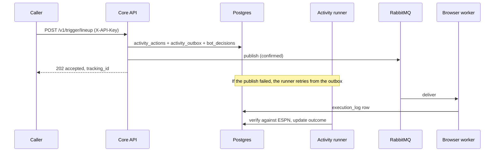
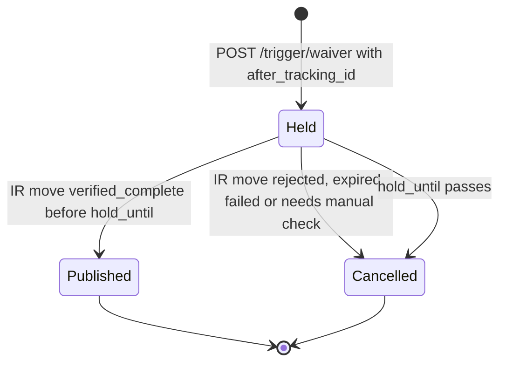

Core publishes to six RabbitMQ queues, all consumed by `fantasy-browser-worker`. The API sends all six, and `sync_players` also publishes straight to `waiver_actions`. Every message is durable JSON on the default exchange, with the queue name as the routing key.

:::tip[Accepted is not done]
A `202` or `queued` status means the message left core, not that ESPN changed. The worker confirms results into `execution_log`, and the activity runner verifies them. See [Activity submissions](./activity-api.md).
:::

## How does a message get from a request to the worker?



Trigger queues go through the **outbox**. The API saves the action and the message in one transaction, publishes immediately, and leaves retries to the activity runner. A saved message is never lost if the broker is down.

The trade queues skip the outbox. They claim the offer in `execution_log` first, then publish, and reconcile by hand if the result is uncertain.

## What queues are there?

| Queue | Path | Source | Idempotency key |
|---|---|---|---|
| `lineup_updates` | Outbox | `POST /v1/trigger/lineup` | `lineup-<team>-<hash>` |
| `waiver_actions` | Outbox | `POST /v1/trigger/waiver` | `waiver-<team>-<hash>` |
| `draft_targets` | Outbox | `POST /v1/trigger/draft-pick` | `<league>:<pick_number>:<espn_id>` |
| `trade_submissions` | Direct from API | `POST /v1/trade/offers/{offer_key}/approve` | `offer_key` |
| `trade_responses` | Direct from API | `POST /v1/trade/incoming/{id}/decision` and `.../decision/retry` | `decision_key` |
| `trade_negotiations` | Direct from API | `POST /v1/trade/incoming/{id}/counter` | Publication key in `outcome_details` |
| `waiver_actions` (alerts) | Ingestor | `sync_players` | None |

The outbox publishes with a passive queue declaration, so `lineup_updates`, `waiver_actions` and `draft_targets` must already exist on the broker. The trade queues are declared durable on publish.

:::note
`POST /v1/trigger/rumor-action` has no queue of its own. It evaluates rumor signals and sends the resulting moves through the lineup and waiver triggers.
:::

## What do the messages contain?

Every message carries a `traceparent` field, and the same value goes in the AMQP headers, so a worker span can join the API's trace. It is separate from `tracking_id`, which is the human-facing UUID. Ids are always **ESPN ids**, never Sleeper `players.player_id`; the API rejects a Sleeper id with a 422.

### `lineup_updates`

| Field | Type | Meaning |
|---|---|---|
| `team_id` | string | Our team. |
| `optimized_swaps` | array | Entries applied in one ESPN transaction. |
| `idempotency_key` | string, optional | See [Idempotency](#how-does-idempotency-work). |
| `tracking_id` | string | Added by core. |

Each entry is one of:

| Entry | Fields |
|---|---|
| Swap (no `kind`) | `drop_player_id`, `add_player_id`, `slot`, `matchup_multiplier?`, and optional names for the id check. |
| IR move (`kind: "ir"`) | `player_id`, `slot: "IR"`, `player_name?` |
| IR activation (`kind: "activate_ir"`) | `player_id`, `slot` (any non-IR slot, normally `BENCH`), `player_name?` |

`decision_inputs` and `kind` on a swap are stripped before publishing. Core does not check IR eligibility; the worker reads ESPN live and rejects ineligible moves.

### `waiver_actions`

| Field | Type | Meaning |
|---|---|---|
| `team_id`, `player_id`, `name`, `team` | string | The free agent to claim. |
| `drop_player_id` | string, optional | Omit for an add-only claim into an open slot. |
| `dry_run` | boolean, optional | Overrides the worker's `DRY_RUN`. |
| `idempotency_key`, `tracking_id` | string | As above. |

`after_tracking_id` is request-only. It holds the claim until the named IR move is verified, and it never appears in the queued message. See [Held claims](#how-does-a-claim-wait-for-an-ir-move).

### `draft_targets`

| Field | Type | Meaning |
|---|---|---|
| `team_id`, `player_id`, `name`, `position`, `pro_team` | string | The target, matched by name, position and team. |
| `league_id`, `pick_number` | string, number | The slot the target is for. |
| `expires_at` | number | Unix time after which the pick is dropped. |
| `mode` | `live` or `practice` | Lets the worker submit for real in a practice room. |
| `idempotency_key` | string | Stable per pick. |

The route returns 409 if the pick is already filled or `expires_at` has passed, and the outbox expires a target that goes stale while waiting. On a delivery failure the route returns 503, and the caller retries with the same key.

### `trade_submissions`, `trade_responses`, `trade_negotiations`

| Queue | Fields |
|---|---|
| `trade_submissions` | `tracking_id`, `season`, `to_team_id`, `incoming_player_ids`, `outgoing_player_ids`, `source`, `approval {offer_key, approved_by}`, optional `message`, `related_transaction_id`, `thread_root_id`. |
| `trade_responses` | `tracking_id`, `espn_transaction_id`, `action`, `approval {decision_key, approved_by, reviewed_note}`, optional `comment`. |
| `trade_negotiations` | `tracking_id`, `season`, `week`, `offering_team_id`, `incoming_player_ids`, `outgoing_player_ids`, `related_transaction_id`, `thread_root_id`. |

`trade_negotiations` carries internal player ids, because the worker stages the counter from core's player mapping. Contract details, including the review token each of these requires, are in [Incoming trade inbox API](./trade-inbox-api.md).

### Direct publisher: injury alerts

`sync_players` publishes straight to `waiver_actions`, bypassing the API, when a rostered player's injury status changes to `Questionable`, `Doubtful` or `Out`. It declares the queue passively, so it fails if the queue is missing.

```json title="Injury alert (waiver_actions)"
{
  "event_type": "INJURY_STATUS_CHANGE",
  "timestamp": "2026-10-04T15:00:00+00:00",
  "player_id": "<sleeper player_id>",
  "name": "Example Player",
  "team": "XYZ",
  "new_injury_status": "Questionable"
}
```

This message has no `team_id` or `tracking_id`, and it uses the Sleeper id. A consumer must not treat it like a claim.

## How does idempotency work?

A repeated request returns `status: "duplicate"` with the original `tracking_id` instead of publishing again. The guard is a unique index on `activity_actions(league_id, kind, idempotency_key)`, where `kind` is the queue name.

| Rule | Detail |
|---|---|
| Season and week suffix | If `decision_inputs` has `season` and `week`, they are appended to the key, so a week-old key can't swallow next week's action. |
| Reuse window | After a key's action has finished (not queued, delivered or running) and the TTL has passed, the key is released and can be used again. |
| Pending work | An action still queued, delivered or running keeps its key, however old. |
| No key | The request always publishes. The web UI's manual moves omit it. |

| Queue | Key release TTL | How the caller builds the key |
|---|---|---|
| `lineup_updates` | 30 min | SHA-256 of the Job name, team, season and week, and the sorted swaps. The Job name comes from the CronJob's downward API, so each new Job publishes but pod retries within one Job don't. |
| `waiver_actions` | 7 days | SHA-256 of team, season, week, add and drop, plus the IR player if chained. No Job name: a claim stays queued on ESPN until waivers process, so any re-run that week must dedupe. If season or week is missing, no key is sent. |
| `draft_targets` | 15 min | `<league_id>:<pick_number>:<espn_id>`. |

Callers retry connection errors, timeouts and 5xx responses, six attempts with a 5 s delay that doubles to 30 s. They never retry a 4xx.

## How does a claim wait for an IR move?

An add-only waiver claim can be chained behind an IR move that makes room for it.



| Rule | Detail |
|---|---|
| Caller order | Post the IR move to `/v1/trigger/lineup` first. Then post the claim with `after_tracking_id` set to the returned `tracking_id`. |
| Requirements | The claim must omit `drop_player_id`. The parent must exist, belong to the same team, contain an `ir` entry and not be failed. |
| Hold length | `ACTIVITY_DEPENDENCY_HOLD_SECONDS`, default 3600. |
| Failure | A cancelled claim is marked `skipped` and its key is released, so a fresh IR move can queue a new claim. |
| Transient parent failure | The claim stays held. |
| Unreadable parent | The route returns 503 and queues nothing. |

## Related

- [API reference](./api-reference.md): which endpoints publish and which need an API key.
- [Activity submissions](./activity-api.md): reading an action's delivery and verification state.
- [Incoming trade inbox API](./trade-inbox-api.md): the trade message contracts and recovery.
- [ESPN reverse engineering notes](https://github.com/cvillarr23/fantasy-browser-worker/blob/main/docs/espn-reverse-engineering.md): how the worker acts on these messages.
