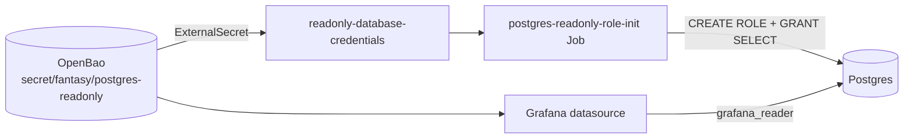

`grafana_reader` is a Postgres role that can read every table and change nothing. Grafana's `FantasyFootballDB` datasource uses it, and you can use it to inspect data without risking a write. Use it instead of `bot_admin` for any query you don't intend to change data with.

## What can the role do?

| Capability | Granted |
|---|---|
| Connect to the `fantasy_football` database | Yes |
| `SELECT` on every table in the `public` schema | Yes, including tables created later |
| `INSERT`, `UPDATE`, `DELETE`, DDL | No |

Core's migrations run as `bot_admin`. A default privilege on that role's new tables grants `SELECT` to `grafana_reader` automatically, so a new table needs no extra step.

:::warning[It reads everything]
The grant is for the whole schema. That includes `activity_actions.payload`, `execution_log.error_message` and `llm_call_metrics`. Secret-looking keys are redacted from stored activity payloads, but treat query output as internal, and don't paste it into public issues.
:::

## Where does the role come from?



The role is defined in `fantasy-infra`, not in this repo: `base/databases/postgres-readonly-role-job.yaml`. The Job runs once as `bot_admin` and is safe to re-run; it sets the password to the current OpenBao value each time.

| Item | Value |
|---|---|
| Role | `grafana_reader` |
| Database | `fantasy_football` |
| Password | OpenBao key `fantasy/postgres-readonly`, property `readonly-password` |
| Provisioned by | `fantasy-infra`, `base/databases/postgres-readonly-role-job.yaml` |
| Consumed by | Grafana datasource `FantasyFootballDB` in `homelab-deployment` |

## How do I connect for debugging?

<details>
<summary>Open a psql session from your machine</summary>

You need a way to reach the database host, such as a port-forward to the Postgres service. Then read the password from OpenBao (see the `bao-login` workflow) and connect:

```bash
export PGPASSWORD="$(bao kv get -field=readonly-password secret/fantasy/postgres-readonly)"
psql -h <db-host> -U grafana_reader -d fantasy_football
```

Replace `<db-host>` with the Postgres host or your forwarded `localhost`. Don't put the password on the command line or in a file.
</details>

## What can I query?

Dashboards in `fantasy-infra` (`base/core-pipeline/*-dashboard.yaml`) read from these tables.

| Dashboard | Main tables |
|---|---|
| Execution log | `execution_log` |
| Bot decisions | `bot_decisions` |
| Backtests | `backtest_results` |
| Draft pipeline | `draft_picks`, `draft_slots`, `draft_config`, `execution_log` |

### Example queries

```sql title="Recent worker failures"
SELECT executed_at, transaction_type, bot_name, error_message
FROM execution_log
WHERE status IN ('failure', 'partial_failure')
ORDER BY executed_at DESC
LIMIT 20;
```

```sql title="Why did we make this lineup change?"
SELECT decided_at, action, target_player_id, drop_player_id,
       season, week, inputs
FROM bot_decisions
WHERE tracking_id = '<tracking-id>';
```

```sql title="Top VORP this week"
SELECT p.name, p.position, w.projected_points, w.vorp_score
FROM weekly_stats w
JOIN players p USING (player_id)
WHERE w.season = 2026 AND w.week = 6
ORDER BY w.vorp_score DESC
LIMIT 25;
```

```sql title="Incoming trade offers awaiting a decision"
SELECT id, status, counter_offer->>'espn_transaction_id' AS tx,
       counter_offer->'score'->>'final_score' AS score
FROM execution_log
WHERE transaction_type = 'trade_inbox' AND status = 'open'
ORDER BY executed_at DESC;
```

:::tip
Always filter `weekly_stats` on both `season` and `week`. Join on `player_id` only for Sleeper ids; use `players.espn_id` to match ESPN ids, and never compare the two spaces directly.
:::

## Related

- [Data model](./data-model.md): the tables and their JSONB columns.
- [Migrations](./migrations.md): why new tables become readable on their own.
